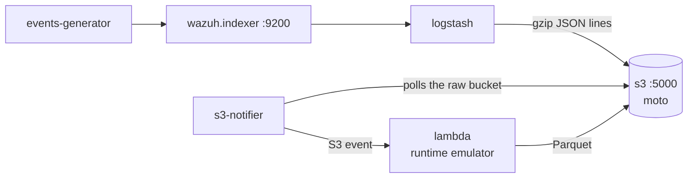

# Amazon Security Lake environment

Development environment of the [Amazon Security Lake integration](../../ref/integrations/amazon-security-lake.md): `integrations/docker/compose.amazon-security-lake.yml`. It needs no AWS account: stand-ins replace the AWS services. See [Integrations](index.md) for what every environment shares.



| Service | Purpose |
| --- | --- |
| `s3` | The [moto](https://github.com/getmoto/moto) server: S3 (the raw bucket, the Security Lake bucket and the OCSF bucket) and STS. Exposed on port 5000. |
| `lambda` | The function (`integrations/amazon-security-lake/src`) in the Lambda runtime interface emulator of AWS (`integrations/amazon-security-lake/Dockerfile`). |
| `s3-notifier` | Stands in for the S3 event notifications (`integrations/amazon-security-lake/dev/s3_notifier.py`): creates the buckets, polls the raw bucket and invokes the function once for every new object, with the event S3 sends. |
| `logstash` | The pipeline of the integration: `10-wazuh-indexer-input.conf`, `20-wazuh-source.conf` and `40-indexer-to-s3.conf`, exporting the findings only (`SECURITY_LAKE_EXPORT_INDICES`). |

The buckets, the account and the location of the custom source are settings of `docker/.env` (`S3_BUCKET_RAW`, `SECURITY_LAKE_BUCKET`, `SECURITY_LAKE_SOURCE_LOCATION`, `SECURITY_LAKE_ACCOUNT_ID`). Logstash uploads a file every `S3_TIME_FILE` minutes, 1 in the environment.

Start it:

```bash
cd integrations/docker
docker compose -f compose.amazon-security-lake.yml up -d --build
```

The Parquet files appear in the Security Lake bucket about eight minutes after Logstash starts. List them, and read one, from the `lambda` container:

```bash
docker compose -f compose.amazon-security-lake.yml exec lambda python -c "
import boto3, io, os, pyarrow.parquet as pq
s3 = boto3.client('s3', endpoint_url=os.environ['AWS_ENDPOINT'])
keys = [o['Key'] for o in s3.list_objects_v2(Bucket=os.environ['AWS_BUCKET']).get('Contents', [])]
print(*keys, sep='\n')
print(pq.read_table(io.BytesIO(s3.get_object(Bucket=os.environ['AWS_BUCKET'], Key=keys[0])['Body'].read())).to_pylist()[0])
import sys; sys.stdout.flush(); os._exit(0)"
```

The OCSF bucket (`S3_BUCKET_OCSF`) holds the same findings as JSON. To export a custom data stream of findings, start the environment with `WAZUH_CUSTOM_KIND=findings`, so that the events generator copies findings into `WAZUH_CUSTOM_STREAM`, and add the stream to `SECURITY_LAKE_EXPORT_INDICES`.

## The function

`integrations/amazon-security-lake/src`:

| File | Contents |
| --- | --- |
| `lambda_function.py` | The handler: reads the files of the S3 event, converts them, writes the Parquet files to the partition of the custom source, with the role of the source when `ROLE_ARN` is set. |
| `wazuh_ocsf_converter.py` | The conversion of a WCS finding into an OCSF Detection Finding. `MAPPED_FIELDS` lists the WCS fields it maps; every other field goes to `unmapped`. |
| `ocsf.py` | The OCSF constants and the fixed Parquet schema of the files. |

`make` builds the package deployed to AWS, `wazuh_to_amazon_security_lake.zip`, with the dependencies of `requirements.aws.txt` for the Lambda runtime.

## Tests

The unit tests (`integrations/amazon-security-lake/tests`) run with moto, with no AWS account:

```bash
cd integrations/amazon-security-lake/tests
pip install -r requirements.txt
python -m pytest
```

They convert every finding the events generator builds from its samples, check that the mapped fields exist in the WCS findings module and that every other field reaches `unmapped`, and run the handler against mocked buckets and STS: partitions, retries, cross-account role, invalid lines.

The end-to-end test runs on the environment:

```bash
python3 integrations/tools/e2e/run.py amazon-security-lake
```

For every scenario it compares the findings of the time range in the Wazuh indexer with the Parquet files in the Security Lake bucket, by the id of the finding, and checks their partition (`eventDay` of their time) and their data stream (`metadata.log_name`). The `findings-and-events` and `events` scenarios check that no event reaches Security Lake.

## Testing on AWS

The stand-ins cover S3, STS and the invocation of the function, but not Security Lake itself. Before a release, validate the integration once on an AWS account with Security Lake enabled, following the [deployment guide](../../ref/integrations/amazon-security-lake.md), and check:

1. The custom source accepts the files: Parquet files under `ext/<source location>/region=<region>/accountId=<account>/eventDay=<day>/`, with no `AccessDenied` in the logs of the function.
2. Security Lake catalogs them: the table of the custom source in AWS Glue has the columns of the schema, and its partitions list the days written.
3. Athena reads them: `SELECT time, severity, finding_info.title, unmapped FROM <table> LIMIT 10` returns the findings, with every column of the expected type.
4. The cross-account setup works, with the function in another account (`ROLE_ARN`, `EXTERNAL_ID`).
5. A retried invocation (re-upload a raw file) overwrites its Parquet file instead of adding another.
