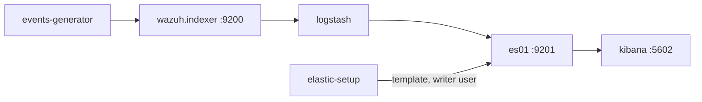

# Elasticsearch environment

Development environment of the [Elasticsearch integration](../../ref/integrations/elastic.md): `integrations/docker/compose.indexer-elastic.yml`. See [Integrations](index.md) for what every environment shares.



| Service | Purpose |
| --- | --- |
| `setup` | Generates the certificates of Elasticsearch and Kibana into the `es_certs` volume, and sets the password of `kibana_system`. |
| `es01` | Elasticsearch, single node, with security and TLS. Exposed on port 9201. |
| `elastic-setup` | Runs `docker/setup/elastic-destination.sh`: installs the index template, and creates the `wazuh-logstash-writer` role and the `wazuh-logstash` user. |
| `kibana` | Kibana, exposed on <https://localhost:5602>. |
| `logstash` | The pipeline of the integration: `10-wazuh-indexer-input.conf`, `20-wazuh-source.conf`, `30-wazuh-data-stream.conf` and `40-indexer-to-elastic.conf`. |

Start it, then import the dashboards:

```bash
cd integrations/docker
docker compose -f compose.indexer-elastic.yml up -d --build
curl -sk -u elastic:elastic -X POST "https://localhost:5602/api/saved_objects/_import?overwrite=true" \
  -H 'kbn-xsrf: true' --form file=@../elastic/dashboards.ndjson
```

Log in to Kibana as `elastic` with the `ELASTIC_PASSWORD` of `docker/.env`. The documents appear in the `logs-wazuh.*` data streams about six minutes after Logstash starts:

```bash
curl -sk -u elastic:elastic "https://localhost:9201/_cat/indices/.ds-logs-wazuh*?v&h=index,docs.count"
```

Elasticsearch creates them in the `logsdb` index mode, which Elasticsearch 9 applies to the `logs-*-*` data streams, with the `logs` lifecycle policy of `logs@settings`.

Test the integration:

```bash
python3 integrations/tools/e2e/run.py elastic
```
