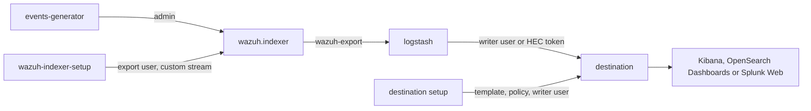

# Integrations

The [`integrations`](https://github.com/wazuh/wazuh-indexer-plugins/tree/main/integrations) folder holds the integrations that export the Wazuh indexer data to Elasticsearch, OpenSearch and Splunk, their development environments and their tests. This section is for developers of the integrations. To deploy them, see the [reference manual](../../ref/integrations/index.md).

- [Elasticsearch](elastic.md)
- [OpenSearch](opensearch.md)
- [Splunk](splunk.md)

## Layout

| Path | Contents |
| --- | --- |
| `logstash/` | The Logstash image of the environments (`Dockerfile`) and the pipeline files shared by every integration (`pipeline/`). |
| `elastic/`, `opensearch/` | The output of the integration, its index template (`templates/`, generated) and its dashboards (`dashboards.ndjson`, generated). `opensearch/` also holds the ISM policy and the configuration of the destination cluster of the environment. |
| `splunk/` | The output of the integration, and the Splunk app (`app/wazuh_integration`): indexes, sourcetypes, search macros and dashboards (generated). |
| `docker/` | The Docker Compose environments: `compose.wazuh-indexer.yml`, the Wazuh indexer and the events generator shared by all of them, one `compose.indexer-<integration>.yml` per integration, the settings (`.env`) and the setup scripts (`setup/`). |
| `tools/events-generator/` | Generator of WCS events and findings. |
| `tools/templates/` | Generator of the index templates. |
| `tools/dashboards/` | Generator of the dashboards. |
| `tools/e2e/` | End-to-end test of an integration. |
| `amazon-security-lake/` | The Amazon Security Lake integration, **not adapted to Wazuh 5.x yet.** |

## Development environments

Every integration has a Docker Compose environment with:

- The Wazuh indexer, with its development certificates, and a setup container that waits for the setup plugin to create the data streams, then creates the read-only export user and a custom data stream (`WAZUH_CUSTOM_STREAM`) to test the export of data streams other than the Wazuh ones.
- The events generator, writing events and findings into the Wazuh indexer.
- The destination platform, with a setup container that installs what the integration needs on it and creates the user Logstash writes with.
- Logstash, running the pipeline of the integration with the settings of `docker/.env`.



Requirements: Docker with Compose 2.20 or later (the environments use `include`), about 8 GB of memory for the Elasticsearch environment, and Python 3.10 or later with `requests` for the tests. The Wazuh indexer binds its transport to the loopback interface, and the destinations run as single-node clusters, so the hosts need no `vm.max_map_count` change.

Start an environment from `integrations/docker`:

```bash
docker compose -f compose.indexer-<integration>.yml up -d --build
```

Stop it and remove its data:

```bash
docker compose -f compose.indexer-<integration>.yml down -v
```

The certificates are generated into `docker/certs` on the first start, and reused afterwards. They are for these environments only.

### Settings

`docker/.env` holds the versions of every component, the development credentials and the export settings: `WAZUH_EXPORT_INDICES`, `WAZUH_EXPORT_LOOKBACK`, `WAZUH_EXPORT_DELAY` and `WAZUH_EXPORT_SCHEDULE` (see [Settings](../../ref/integrations/index.md#settings)). Change them there, or override them for one run in the environment:

```bash
WAZUH_EXPORT_INDICES=wazuh-findings-v5-*,wazuh-custom-test docker compose -f compose.indexer-elastic.yml up -d logstash
```

With the default delay, the first documents reach the destination about six minutes after Logstash starts.

## Events generator

[`tools/events-generator`](https://github.com/wazuh/wazuh-indexer-plugins/tree/main/integrations/tools/events-generator) indexes WCS events into the `wazuh-events-v5-<category>` data streams and, for a share of them, the findings a detector would produce into `wazuh-findings-v5-<category>`. It builds them from the templates under `samples/`:

- `events.json`: one event template per integration, covering every category.
- `agents.json`: the agents that collect the events, and the cluster that processes them.
- `rules.json`: the rules that produce the findings, with their MITRE ATT&CK and compliance fields.

A finding is built as Ruleset Management builds it: a copy of the event, with `event.doc_id` and `event.index` pointing at it, the rule under `wazuh.rule`, and the document id the Security Analytics plugin computes for it. It is indexed `WAZUH_GENERATOR_FINDINGS_DELAY` seconds after its event (150 in the environments), as the detectors index findings on their own schedule.

```bash
cd integrations/tools/events-generator
python3 run.py --help
python3 run.py --dry-run --count 3 --seed 1     # print three events and their findings
python3 -m pytest                                # unit tests
```

The unit tests check every sample event and finding against the WCS field definitions (`wcs/stateless/events/{main,findings}/docs/fields.csv`). Add a sample whenever an integration needs data that the others do not have.

## Index templates

The index templates the Elasticsearch and OpenSearch integrations install are generated from the index templates the setup plugin installs for the source data streams (`plugins/setup/src/main/resources/templates/streams/{events,findings}.json`): the union of the WCS events and findings fields, as dynamic templates. Only what the destination does not support is translated: the `zstd` codec becomes `best_compression`, and `flat_object` becomes `flattened` in Elasticsearch.

Regenerate them after any change to the WCS, and commit the result:

```bash
python3 integrations/tools/templates/generate.py
python3 integrations/tools/templates/generate.py --check   # fails if a committed template is out of date
```

## Dashboards

The dashboards are built from code in `integrations/tools/dashboards`, one module per platform (`kibana.py`, `opensearch.py`, `splunk.py`).

The three integrations reuse the dashboards of the Wazuh dashboard: the integrations export the findings with the same WCS fields it reads.

- `wazuh_dashboard.py` lists the dashboards of the Wazuh dashboard built on the findings, except those it embeds in other pages, with the filter the Wazuh dashboard applies to the module of each one. Their definitions are copied from `wazuh-dashboard-plugins`, at the version of `VERSION`, in `wazuh-dashboard/<version>/`, with the paths of the source.
- A visualization shared by several definitions is one object, resolved as the Wazuh dashboard does: it loads the definitions in the order of their paths, and the last one wins.
- The Wazuh dashboard renders the saved dashboards as they are, so the conversion keeps their panels, layout and options, and changes only:
  - the index pattern, to that of the exported findings;
  - the filter of the module, added to the dashboard;
  - the ids, prefixed with `wazuh-`, so that they never clash with the objects of a Wazuh dashboard;
  - the titles: `Wazuh - ` before the dashboards, and a name for the visualizations without one, whose panels keep no title;
  - a panel on top of the dashboards scoped to one value, to pick it as the Wazuh dashboard does: an options list of the agents in the agent dashboards, and a table of the values of the module in the drilldowns (an options list would offer the values of every module).
- **OpenSearch** (`opensearch.py`) imports those saved objects. The generator fails if a visualization aggregates on a field that is not an aggregatable WCS field.
- **Elasticsearch** (`kibana.py`) imports the same saved objects: Kibana still renders the aggregation-based visualizations of OpenSearch Dashboards and migrates them on import. Only the parameters OpenSearch Dashboards renamed are changed back (`RENAMED`).
- **Splunk** (`splunk.py`) translates every visualization to a search and a visualization of Dashboard Studio, in the same place of the same layout:
  - the aggregations to `stats`, `chart` and `timechart`, the heatmaps to punchcards, the metrics to single values;
  - the fields to their Splunk names, with `{}` after every array of the WCS findings fields (`wazuh.rule.compliance.pci_dss{}`);
  - the panel that picks the value of a dashboard to a dropdown input, which only lists the values of the module.
  The generator fails on an aggregation or a query it does not translate.

To follow a new version of the Wazuh dashboard, set `VERSION`, download its definitions and regenerate:

```bash
python3 integrations/tools/dashboards/wazuh_dashboard.py
python3 integrations/tools/dashboards/generate.py
```

The Wazuh dashboard has no dashboard of events, so every integration keeps its own **Events overview**, with the same panels: events by category, outcome, integration and agent, authentication failures and cloud activity.

Change a dashboard in its module, then regenerate:

```bash
python3 integrations/tools/dashboards/generate.py
python3 integrations/tools/dashboards/generate.py --check
```

## End-to-end test

`integrations/tools/e2e/run.py` tests an integration on its development environment. For every index pattern scenario (findings and events, findings only, events only, the custom data stream) it configures Logstash, lets the events generator run, stops it, waits for the export of the time range, and checks that:

- every document of the exported sources reached the destination, once;
- no document of the other sources did;
- every document reached the destination of its source.

Then it imports the dashboards (Elasticsearch and OpenSearch) or checks the dashboards of the Splunk app.

```bash
python3 integrations/tools/e2e/run.py elastic
python3 integrations/tools/e2e/run.py splunk --scenarios findings custom --keep
```

`--keep` leaves the environment running to inspect it. Every scenario waits for the export window to pass (`WAZUH_EXPORT_LOOKBACK` + `WAZUH_EXPORT_DELAY`, plus a margin), so a run of the four scenarios takes about 40 minutes.

## Continuous integration

The `(5.x) Test the integrations` workflow (`.github/workflows/5_testintegration_integrations.yml`) runs on pull requests that change the integrations or the source index templates: the unit tests of the events generator, the `--check` of the templates and dashboards generators, and the end-to-end test of every integration.

What it cannot test: the deployment on production platforms (managed Elasticsearch, Splunk Cloud), and the behavior of the real detectors. The environments do not run detectors: the events generator writes the findings itself.
