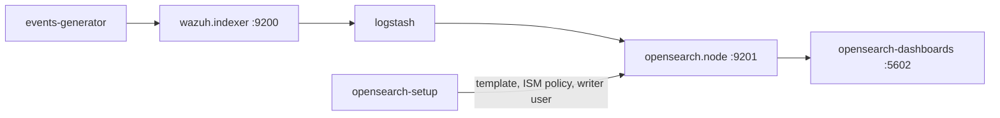

# OpenSearch environment

Development environment of the [OpenSearch integration](../../ref/integrations/opensearch.md): `integrations/docker/compose.indexer-opensearch.yml`. See [Integrations](index.md) for what every environment shares.



| Service | Purpose |
| --- | --- |
| `opensearch.node` | The destination OpenSearch cluster, single node, with the security plugin and the certificates of the environment (`integrations/opensearch/opensearch.yml`). Exposed on port 9201. |
| `opensearch-setup` | Runs `docker/setup/opensearch-destination.sh`: installs the index template and the `wazuh-logs` ISM policy, and creates the `wazuh-logstash-writer` role and the `wazuh-logstash` user. |
| `opensearch-dashboards` | OpenSearch Dashboards, exposed on <https://localhost:5602>. |
| `logstash` | The pipeline of the integration: `10-wazuh-indexer-input.conf`, `20-wazuh-source.conf`, `30-wazuh-data-stream.conf` and `40-indexer-to-opensearch.conf`. |

Start it, then import the dashboards:

```bash
cd integrations/docker
docker compose -f compose.indexer-opensearch.yml up -d --build
curl -sk -u admin:admin -X POST "https://localhost:5602/api/saved_objects/_import?overwrite=true" \
  -H 'osd-xsrf: true' --form file=@../opensearch/dashboards.ndjson
```

Log in to OpenSearch Dashboards as `admin` with the `OPENSEARCH_ADMIN_PASSWORD` of `docker/.env`. The documents appear in the `logs-wazuh.*` data streams about six minutes after Logstash starts:

```bash
curl -sk -u admin:admin "https://localhost:9201/_cat/indices/.ds-logs-wazuh*?v&h=index,docs.count"
```

Test the integration:

```bash
python3 integrations/tools/e2e/run.py opensearch
```
