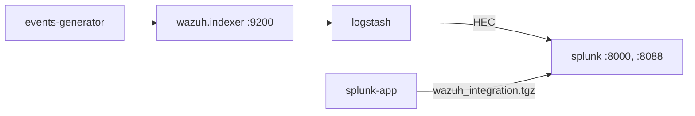

# Splunk environment

Development environment of the [Splunk integration](../../ref/integrations/splunk.md): `integrations/docker/compose.indexer-splunk.yml`. See [Integrations](index.md) for what every environment shares.



| Service | Purpose |
| --- | --- |
| `generator` | Issues the certificate of Splunk with the CA of the environment. |
| `splunk-app` | Packages the Wazuh app (`integrations/splunk/app/wazuh_integration`) into a volume, as it is distributed. Splunk changes the owner of the apps it finds in place, so the app is never mounted from the repository. |
| `splunk` | Splunk Enterprise, which installs the app on start (`SPLUNK_APPS_URL`) and enables HEC with the `SPLUNK_HEC_TOKEN` of `docker/.env` (`integrations/splunk/config/default.yml`). Splunk Web is exposed on <https://localhost:8000>, HEC on port 8088. |
| `logstash` | The pipeline of the integration: `10-wazuh-indexer-input.conf`, `20-wazuh-source.conf` and `40-indexer-to-splunk.conf`. |

Start it:

```bash
cd integrations/docker
docker compose -f compose.indexer-splunk.yml up -d --build
```

Log in to Splunk Web as `admin` with the `SPLUNK_PASSWORD` of `docker/.env`, and open the **Wazuh** app. The events appear about six minutes after Logstash starts:

```
`wazuh_findings` | stats count by source
```

The app is installed when Splunk starts: after changing it, recreate the `splunk-app` and `splunk` services, which installs the new package.

```bash
docker compose -f compose.indexer-splunk.yml up -d --force-recreate splunk-app splunk
```

Test the integration:

```bash
python3 integrations/tools/e2e/run.py splunk
```
