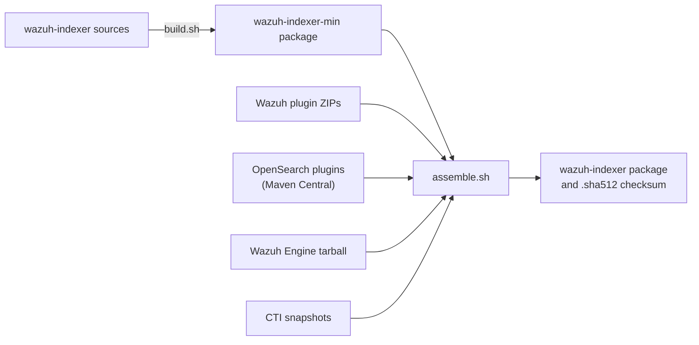

# Packages

This page is for the people who build and maintain the Wazuh Indexer Debian (DEB) and RPM
packages: how a package is put together, how it is named, built in continuous integration (CI)
and tested, and how its maintainer scripts behave on installation, upgrade and removal. For the
commands to build a package yourself, see [Build packages](build-packages.md).

Everything described here lives in the [`wazuh-indexer`](https://github.com/wazuh/wazuh-indexer)
repository, and every path on this page is relative to it: the build tooling is in
`build-scripts/`, the package definitions and maintainer scripts in `distribution/packages/src/`.

- [Packages](#packages)
  - [Supported systems](#supported-systems)
  - [How a package is built](#how-a-package-is-built)
    - [Build](#build)
    - [Assemble](#assemble)
    - [The Docker builder](#the-docker-builder)
    - [The artifacts directory](#the-artifacts-directory)
  - [Package naming](#package-naming)
  - [Continuous integration](#continuous-integration)
  - [Testing](#testing)
  - [Maintainer scripts](#maintainer-scripts)
    - [Upgrades keep the service state](#upgrades-keep-the-service-state)
    - [Configuration files](#configuration-files)
    - [Further reading](#further-reading)
  - [Credential and TLS resolution](#credential-and-tls-resolution)
    - [Where things live](#where-things-live)
    - [Resolution happens once](#resolution-happens-once)
    - [The password rule](#the-password-rule)
    - [How a password reaches the cluster](#how-a-password-reaches-the-cluster)
    - [Resolver modes](#resolver-modes)
    - [Certificate resolution](#certificate-resolution)
  - [File ownership](#file-ownership)
    - [When the package is purged](#when-the-package-is-purged)
  - [Host dependencies](#host-dependencies)

## Supported systems

The build produces three formats, `deb`, `rpm` and `tar`, each for the `x64` and `arm64`
architectures. Windows is not supported.

The operating systems the packages are supported and tested on are listed in
[Compatibility](../ref/compatibility.md). That table is the one to update when support changes,
and it must always match the list in the
[Wazuh documentation](https://documentation.wazuh.com/current/installation-guide/wazuh-indexer/index.html).
The Indexer team keeps both up to date.

## How a package is built

A package is built in two stages, each driven by its own script:

- **Build** — `build-scripts/build.sh` compiles the OpenSearch fork with Gradle and produces the
  *minimal package*, `wazuh-indexer-min`: the search engine alone, with no plugins and no Wazuh
  configuration.
- **Assemble** — `build-scripts/assemble.sh` unpacks the minimal package, adds everything that
  makes it the Wazuh Indexer, and packs the *final package*, `wazuh-indexer`, the one installed
  on hosts.



GitHub Actions provides the infrastructure, but the build logic is self-contained in Gradle and
these Bash scripts, so the same process runs unchanged in the [Docker builder](#the-docker-builder),
in CI and on a workstation. `build.sh` keeps the shape of the per-component build script that
OpenSearch's [opensearch-build](https://github.com/opensearch-project/opensearch-build/tree/main/src/build_workflow#custom-build-scripts)
repository expects, which is why it also publishes Maven artifacts.

### Build

`build.sh` runs `publishToMavenLocal` and `publishNebulaPublicationToTestRepository`, then the
`:distribution:<type>:<target>:assemble` Gradle task for the requested format and architecture
(`<type>` is `packages` for DEB and RPM, `archives` for the tarball), and bundles the
`workload-management` plugin, which is built from this repository rather than downloaded. Gradle
writes the package to `distribution/<type>/<target>/build/distributions/`, and the script copies
it to `artifacts/dist/` under the name given with `-n`.

### Assemble

`assemble.sh` finds the minimal package in `artifacts/dist/`, unpacks it in `artifacts/tmp/`
(with `ar` and `tar` for DEB, `rpm2cpio` and `cpio` for RPM), and then:

1. Writes `VERSION.json` into the product directory, with a `commit` field holding the commit
   hashes the package was built from (see [Package naming](#package-naming)).
2. Installs the plugins with `opensearch-plugin`, from three lists at the top of the script:
   `plugins`, the OpenSearch plugins, downloaded from Maven Central at the OpenSearch version in
   `buildSrc/version.properties`; `internal_plugins`, built by `build.sh`; and `wazuh_plugins`,
   read from `artifacts/plugins/`.
3. Copies the Content Manager's Cyber Threat Intelligence (CTI) snapshots, when
   `artifacts/snapshots/` exists, into `plugins/wazuh-indexer-content-manager/snapshots/`.
4. Installs the Wazuh Engine from the tarball in `artifacts/engine/` into `engine/`.
5. Applies the Wazuh configuration. Once the Security plugin has created its default files in
   `opensearch-security/`, the script appends Wazuh's `*.wazuh.yml` files to them (see
   [Security](plugins/security.md)), deletes the demo users and role mappings the product does not
   use, replaces the `admin` and `kibanaserver` hashes with credential placeholders (see
   [How a password reaches the cluster](#how-a-password-reaches-the-cluster)) and disables
   multi-tenancy. It then installs `opensearch.prod.yml` as `opensearch.yml`, and removes
   symbolic links, `.bat` files and the Security plugin's `install_demo_configuration.sh`.
6. Builds the installation assistant tools from that repository's sources: `config.yml`,
   `wazuh-passwords-tool.sh` and `wazuh-certs-tool.sh` go into `tools/`, with the indexer's own
   `wazuh-indexer-credentials.sh` put in place of the assistant's shared library they embed (see
   [Where things live](#where-things-live)), and that library itself goes into `lib/`.
7. Packs the result, with `debmake` and `debuild` from `distribution/packages/src/deb/`, or with
   `rpmbuild` from `distribution/packages/src/rpm/wazuh-indexer.rpm.spec`. It drops the `-min`
   from the name and writes a `.sha512` checksum beside the package.

Assembly needs network access, to Maven Central and to the installation assistant's repository on
GitHub.

To add a plugin to the package, add an OpenSearch plugin to the `plugins` list in `assemble.sh`.
A Wazuh plugin goes in `wazuh_plugins` there and in the `maven_plugins` list of `copy_builds` in
`build-scripts/builder/entrypoint.sh`; one from a new repository also needs a clone entry and a
build function in that file. A file the service writes at runtime also needs an ownership
exception, as described in [File ownership](#file-ownership).

### The Docker builder

`build-scripts/builder/builder.sh` runs both stages inside a container (`compose.yml` and
`Dockerfile` in the same directory) that carries JDK 21 and every packaging tool, so nothing has
to be installed on the host. The container's `entrypoint.sh`:

1. Clones the six plugin repositories at the branch, tag or commit given for each, into named
   volumes that persist between runs.
2. Downloads the CTI snapshots with `build-scripts/download_snapshots.sh` from `CTI_API_URL`,
   which defaults to the pre-production CTI API.
3. Builds the plugins with `./gradlew publishToMavenLocal -x check`, versioned
   `<version>.<revision>`, in dependency order: Common Utils, Alerting, Security Analytics (its
   `commons` module first), Notifications, Reporting, and last the Setup and Content Manager
   plugins from `wazuh-indexer-plugins`.
4. Copies the plugin ZIPs to `artifacts/plugins/` and the Engine tarball to `artifacts/engine/`.
5. Clears `artifacts/dist/` and `artifacts/tmp/`, names the minimal package with `baptizer.sh`,
   and runs `build.sh` and `assemble.sh`.

The builder's flags and prerequisites, including how to obtain the Engine tarball, are in
[Build packages](build-packages.md).

`build.sh` and `assemble.sh` can also run directly, from the repository root, once
`artifacts/plugins/` and `artifacts/engine/` are populated. The builder exists so that this is
rarely worth doing: the host then needs `jq` at `/usr/bin/jq`, Maven, a JDK and `debmake` or
`rpmbuild`; `assemble.sh` overwrites `~/.devscripts` when it packs a DEB; and a minimal package
left in `artifacts/dist/` by an earlier run breaks assembly, because the script finds the
minimal package by pattern.

### The artifacts directory

Both stages read from and write to `artifacts/`, at the repository root:

| Directory | Contents | Written by |
| --- | --- | --- |
| `dist/` | The minimal package, the final package and its `.sha512` checksum | `build.sh`, `assemble.sh` |
| `maven/` | The OpenSearch fork's Maven publications | `build.sh` |
| `plugins/` | The Wazuh plugin ZIPs | Docker builder |
| `engine/` | The Wazuh Engine tarball | Docker builder |
| `snapshots/` | The CTI snapshots and their `manifest.json` | Docker builder |
| `tmp/` | Scratch space for unpacking, deleted when assembly succeeds | `assemble.sh` |

## Package naming

The stages hand packages to each other by file name, so names are generated rather than typed:
`build-scripts/baptizer.sh` prints the name for a combination of parameters. It only prints, so
it is safe to run with any combination to get familiar with the convention. Run it from the
repository root.

The version comes from the `version` field of `VERSION.json`, and the Wazuh plugins are versioned
`<version>.<revision>` from it. The `stage` field (`rc1`, for example) is not part of the name: it
is only sent as the version tag when the builder requests the CTI snapshots.

There are two conventions:

- **Release** — the name a published package carries. Selected with `-x` (the builder's
  `-S true`, the Workflow's `is_stage`).
  - DEB and tarball: `wazuh-indexer_<version>-<revision>_<architecture>.<extension>`
  - RPM: `wazuh-indexer-<version>-<revision>.<architecture>.rpm`
- **Development** — the default, the same for every format:
  `wazuh-indexer_<version>-<revision>_<architecture>_<commits>.<extension>`. `<commits>` is the
  short hash of the `wazuh-indexer` commit or, when all five plugin hashes are given (the builder
  always gives them), six hashes joined by `-`: `wazuh-indexer`, `wazuh-indexer-plugins`,
  `wazuh-indexer-reporting`, `wazuh-indexer-security-analytics`, `wazuh-indexer-notifications`
  and `wazuh-indexer-alerting`, in that order.

`-m` replaces the `wazuh-indexer` prefix with `wazuh-indexer-min`, the name `build.sh` gives the
minimal package. `assemble.sh` drops the `-min` again.

The architecture is spelled the way each package manager expects:

| Format | `x64` | `arm64` |
| --- | --- | --- |
| DEB | `amd64` | `arm64` |
| RPM | `x86_64` | `aarch64` |
| Tarball | `linux-x64` | `linux-arm64` |

```bash
bash build-scripts/baptizer.sh -d rpm -a x64 -r 0 -x
# wazuh-indexer-5.0.0-0.x86_64.rpm
bash build-scripts/baptizer.sh -d deb -a arm64 -r 0 -x
# wazuh-indexer_5.0.0-0_arm64.deb
bash build-scripts/baptizer.sh -d rpm -a x64 -r 0
# wazuh-indexer_5.0.0-0_x86_64_a55f704b69c.rpm
```

The `commit` field `assemble.sh` writes into `/usr/share/wazuh-indexer/VERSION.json` holds the
same six hashes, so an installed node records what it was built from even under a release name.
The `wazuh-indexer-common-utils` commit, which several of the plugins are built against, appears
in neither the name nor that field.

## Continuous integration

Packages are built by the `5_builderpackage_indexer.yml` Workflow, **(5.x) Build packages**. To
run it by hand, open the repository's **Actions** tab, select **(5.x) Build packages**, fill in the
form and click **Run workflow**. The inputs that change the result:

- **`revision`** (default `0`) — the package revision.
- **`is_stage`** (default `false`) — use the release naming convention.
- **`distribution`** and **`architecture`** — the formats and architectures to build, one job
  per combination.
- **`plugins_ref`** (default `main`) — the branch, tag or commit to build the plugin repositories
  and the Wazuh Engine from. Each repository uses the same-named branch when it has one, and
  otherwise the branch for the product version, so a feature branch pushed with the same name to
  several repositories is built together.
- **`upload`** and **`checksum`** — upload the packages, and their checksums, to the S3 bucket.

The Workflow first checks that every repository declares the same product and OpenSearch
versions (`build-scripts/check_compatibility_versions.sh`) and builds the Wazuh Engine through the
`wazuh/wazuh` repository's `5_builderpackage_engine-standalone.yml`. It then runs the same
`builder.sh` described above, on the dedicated runner, followed by the package tests.
`5_builderpackage_indexer_onpush.yml` calls it for every pull request that is ready for review
and changes more than Markdown files.

## Testing

Every package the Workflow builds is installed, removed and, when a previous version exists,
upgraded, in throwaway containers before it is uploaded. [Package testing](run-tests.md#package-testing) lists those tests and the
scripts behind them.

To try a package on a real service, use the Vagrant environment described in
[Test cluster (Vagrant)](run-tests.md#test-cluster-vagrant). More extensive testing, including
end-to-end (E2E) tests, is done by the quality assurance (QA) team.

## Maintainer scripts

| Package | Scripts | Dependencies |
| --- | --- | --- |
| DEB | `deb/debian/`: `preinst`, `postinst`, `prerm`, `postrm` | `Depends:` in `deb/debian/control` |
| RPM | `rpm/wazuh-indexer.rpm.spec`: `%pre`, `%post`, `%posttrans`, `%preun`, `%postun` | `Requires:` in the spec |

Paths are relative to `distribution/packages/src/`. The systemd unit, its environment file, the
SysV init script and the sysctl settings are shared by both packages, under `common/`. A change to
one package's scripts almost always needs its counterpart in the other.

The two package managers run these scripts in a different order, and that order decides where
each step has to go. [Fedora's scriptlet ordering](https://docs.fedoraproject.org/en-US/packaging-guidelines/Scriptlets/#ordering)
and the [Debian maintainer scripts](https://wiki.debian.org/MaintainerScripts) flowcharts are the
references.

### Upgrades keep the service state

An upgrade leaves the service as it found it: a node that was running is running again afterwards,
with no operator action, and a stopped node stays stopped.

1. Before the new files are unpacked, DEB `preinst upgrade` or RPM `%pre` (with `$1` set to `2`)
   refuses to upgrade a 4.x installation, then stops the service if it is active and creates the
   flag file `/etc/wazuh-indexer/.was_active`.
2. The package manager replaces the files.
3. DEB `postinst configure` (with the previous version in `$2`) or RPM `%posttrans` restarts the
   service if the flag exists, and deletes it. Without the flag, it prints how to start the
   service instead.

The RPM restart is in `%posttrans`, not `%post`, because during an RPM upgrade the new package's
`%post` runs before the old package's `%preun`, its file removal and its `%postun`. `%posttrans`
is the only scriptlet that runs after all of them. The old package's removal scriptlets act only
when `$1` is `0`, a real erase, and DEB `prerm upgrade` and `postrm upgrade` do nothing, so an
upgrade never disables the service. The spec declares the flag file `%ghost`, so RPM owns it
without shipping it.

For the operator's side of an upgrade, see [Upgrade](../ref/upgrade.md).

### Configuration files

The package manager never overwrites a configuration file the operator changed. The two formats
handle the conflict differently:

- **RPM** — the files marked `%config(noreplace)` in `%files`: `opensearch.yml`, `jvm.options`,
  `log4j2.properties`, the `opensearch-security/` files, `/etc/sysconfig/wazuh-indexer` and a few
  others. An upgrade replaces an unmodified file. A modified one is kept, and when the packaged
  version changed, the new version is written beside it with the `.rpmnew` suffix. On erase, a
  modified file is saved with the `.rpmsave` suffix.
- **DEB** — debhelper marks every file under `/etc` as a conffile. An upgrade replaces an
  unmodified conffile. For a modified one whose packaged version also changed, `dpkg` asks the
  operator which to keep, unless `--force-confold` or `--force-confnew` answers for them; the CI
  upgrade tests pass `--force-confnew`. `remove` keeps conffiles and `purge` deletes them.

`resolve-credentials.sh` writes the node and admin distinguished names (DNs) into `opensearch.yml`
and the password digests into `internal_users.yml` when it resolves them, normally at installation,
so on every host both files count as modified from the start. Any change to their shipped content therefore produces an
`.rpmnew` file or a `dpkg` prompt on every upgrade. For the same reason, the RPM erase deletes
their `.rpmsave` copies: they carry credential material.

### Further reading

- [Debian Policy: configuration file handling](https://www.debian.org/doc/debian-policy/ap-pkg-conffiles.html)
- [Debian Wiki: maintainer scripts](https://wiki.debian.org/MaintainerScripts)
- [Fedora Packaging Guidelines: scriptlets](https://docs.fedoraproject.org/en-US/packaging-guidelines/Scriptlets/)
- [rpm.org: spec file format](https://rpm-software-management.github.io/rpm/manual/spec.html)
- [Maximum RPM: directives for the `%files` list](http://ftp.rpm.org/max-rpm/s1-rpm-inside-files-list-directives.html)

## Credential and TLS resolution

The Wazuh Indexer package resolves its own credentials and Transport Layer Security (TLS)
material rather than shipping defaults. This section covers when that runs and what it does; the
commands it needs from the host are listed in [Host dependencies](#host-dependencies). For the
accounts and roles themselves, see [Security](plugins/security.md).

### Where things live

Everything the package resolves is under its own configuration directory, `/etc/wazuh-indexer`,
and nothing is shared with the other Wazuh packages on the host:

| Path | Owner and mode | Holds |
| --- | --- | --- |
| `export/` | `root:wazuh-indexer 0750` | What this package publishes for the Wazuh Manager and the Wazuh Dashboard on the same host: `credentials.env` (`root:root 0600`), with `WAZUH_INDEXER_ADMIN_PASSWORD`, `WAZUH_INDEXER_KIBANASERVER_PASSWORD` and `WAZUH_INDEXER_MANAGER_PASSWORD`; `ca.pem` (`root:wazuh-indexer 0640`), the CA certificate; and the client pairs `manager-client.pem`, `manager-client-key.pem`, `dashboard-client.pem` and `dashboard-client-key.pem` (`root:root 0600`), issued from the CA for the two consumers. |
| `ca/` | `root:wazuh-indexer 0750` | The CA this node issues its certificates from: `root-ca.pem` (`0640`) and `root-ca.key` (`root:root 0400`). The package mints it when the directory is empty and records that in `.wazuh-indexer-bootstrap-ca`; a CA staged there by the operator has no marker, is used as it is and is never removed. |
| `local.env` | `root:root 0600`, optional | The operator's values, read before anything else: a password instead of a generated one, or `WAZUH_INDEXER_CERT_SANS`. The package never writes it. |
| `certs/` | `root:wazuh-indexer 0750` | The node's pair and the CA it trusts, `root:wazuh-indexer 0640`; the admin pair, `root:root 0600`. |

The lookup order for a value is the process environment, then `local.env`, then what the package
already published in `export/credentials.env`, then generation. The indexer owns its three
accounts and consumes nothing from another package, so a password is never left unresolved.

The manager and the dashboard read `export/` when they are installed or started on the same host,
after checking that it is root's; on other hosts the operator copies the values into their own
`local.env` and `certs/`. The names and formats of the files in `export/` are a contract with those
packages.

`lib/wazuh-indexer-credentials.sh`, shipped beside the resolver, is the library that reads and
writes these files, mints and validates the CA, and generates and validates passwords.
`wazuh-certs-tool.sh` and `wazuh-passwords-tool.sh` carry a copy of it, put there by
`assemble.sh` in place of the installation assistant's shared library they are built with.

#### Files root reads and writes

Every file the resolver reads as root must be a regular file, not a symbolic link, owned by root
and writable by nobody else, in a directory with the same properties; `export/` and `ca/` may
carry the service group, never a group write bit, and `local.env`, `export/credentials.env` and
`ca/root-ca.key` must be readable by root alone. Anything else is reported as
`UNSAFE <path>: <reason>`, never repaired and never followed. Writes go to a temporary file in the
target directory followed by a rename, so nothing is ever written through an existing path. The
same checks run at every start — `--check`, which `--prestart` runs first — whether or not anything
is left to resolve, so trust material planted after the install stops the service rather than
being used.

The security plugin walks the whole configuration directory at start and logs a warning for every
file readable by others and every directory others can enter. Nothing under `/etc/wazuh-indexer`
is therefore world-readable, including the CA certificates, which the other packages read as root.
For the same reason `export/` and `ca/` stay `root:wazuh-indexer 0750` and cannot be `0700 root:root`
like the manager's directories: the walk fails with `AccessDeniedException` on a directory the
service account cannot enter, and the node does not start. What the group can read there is only
the public CA certificate; every private key and `credentials.env` is root's alone.

### Resolution happens once

`resolve-credentials.sh` runs from four places — `postinst` / `%post`, the unit's `ExecStartPre`,
the SysV `start` path, and a container entrypoint — but it does its work **once**. A run that
resolves everything it was responsible for records the fact in
`/var/lib/wazuh-indexer/.initialized`, and every later run only checks the files and exits without
resolving anything again.

The marker, not the mode, is what makes that true. Every mode resolves the same things — the
passwords, the certificates and the trust anchor in the bundled JDK — so a run that finds the
marker absent finishes whatever an earlier one could not.

That is not an optimisation. A password an operator rotated, or a certificate pair they replaced
with their own, has to survive a service restart and a package upgrade, and the only way to
guarantee that is to stop looking. A partial run — one that could not issue a certificate, say —
deliberately does **not** record completion, so the next install can still finish the job.

`resolve-credentials.sh --clear` is the one way back. It takes back every half of everything this
component resolved: the passwords and the CA certificate published in `export/` and the digests in
`internal_users.yml`, which return to their `${NAME}` placeholders; the certificates, a CA it minted
itself, and the node and admin DNs derived from them; and the CA entry in the bundled JDK
truststore. A CA the package did not mint — one the operator staged, with or without its key —
stays, and so does `local.env`.

It exists for container images built by installing the package, which would otherwise bake one
host's credentials into a layer every container shares. The next start resolves all of it again.

`indexer-security-init.sh` keeps no state of its own. It is run by an operator, once, and the
package never calls it — so there is nothing for it to guard against repeating.

### The password rule

A password, supplied or generated, has 12 to 64 characters from `A-Z a-z 0-9 . , _ + : @ % ^ = ~ -`, with at least one uppercase letter, one lowercase letter, one digit and one symbol. It is the same rule the Server API applies, so one value is accepted in both realms.

`wazuh_password_validate` in `lib/wazuh-indexer-credentials.sh` is the only place that checks it. The start-time error that names a rejected key restates the rule, so that an operator can correct the value without reading the library.

### How a password reaches the cluster

`internal_users.wazuh.yml` ships each account's `hash` as a `${NAME}` placeholder rather than a digest, so the package carries no usable credential. `resolve-credentials.sh` resolves the value, bcrypts it with the Security plugin's `hash.sh`, and substitutes the digest in place.

The placeholder is deliberately bare. The Security plugin substitutes `${env.X}`, `${envbc.X}` and `${envbase64.X}` itself, node-side, at every configuration load — which would tie each account to a variable that has to stay in the service environment for the life of the deployment. A placeholder with no such prefix is left untouched by the plugin.

The digest and the published password are one credential in two halves, and resolution keeps them together rather than writing either alone. An account whose placeholder is already gone while nothing supplies its password — a host upgrading from a version that predates this mechanism, whose `internal_users.yml` the package manager kept — is reported and left as it is, instead of being given a freshly generated password that its digest would not match.

Loading the result into the cluster stays a manual step, `indexer-security-init.sh`. A package cannot know whether other nodes of the same cluster are still to be installed elsewhere, so running it automatically would either race those nodes or overwrite what they uploaded.

### Resolver modes

`resolve-credentials.sh` takes one of five modes:

- `--install` — from `postinst` / `%post` on a fresh install. Creates what it can and never fails: a maintainer script that aborts leaves the package half-configured. It is the only mode that replaces a DN setting that already has a value.
- `--upgrade` — from `postinst` / `%post` on an upgrade. Fills in only what this host never had.
- `--prestart` — from the unit's `ExecStartPre` and from the SysV `start` path. Runs the file checks first, on every start, then refuses to start the service when something is unresolved or unsafe, naming it.
- `--check` — the file checks alone, for an operator or a test: one line per problem, exit 1 on any. See [Files root reads and writes](#files-root-reads-and-writes).
- `--clear` — takes back everything this component resolved, so a later run resolves from nothing. Nothing in the package calls it; see [Resolution happens once](#resolution-happens-once).

`-q` / `--quiet` silences the progress lines, and is not a mode. The maintainer scripts pass it so that the install ends with the next steps an operator needs — where the passwords are, how to start and enable the service, and that the security configuration is loaded once from one node — rather than with a list of resolved keys. Anything that could not be resolved still prints.

Those closing lines depend on the completion marker. A fresh install that resolved everything says the node is not running yet and gives the start and security-init commands. One that did not says the indexer is installed but not configured, still gives both commands, and leaves the reason to the resolver's error printed just above it. With no keystore, the certificates did not resolve, so it adds where to stage the node's pair and its `root-ca.pem`: `certs/`, `root:wazuh-indexer 0640`. With a keystore, the certificates resolved and the cause is elsewhere, such as a password the policy rejected, so it only asks the operator to correct what is reported. The install exits 0 either way: the package is installed, and the operator stages the prerequisites and starts the service, with no reinstall.

### Certificate resolution

Which case applies is decided entirely by what is present in the certificate authority (CA) directory, with no mode flag — the presence of a private key beside the trust anchor is the signal, so a host never given one cannot sign:

| In the CA directory | Pair already in place | Result |
| --- | --- | --- |
| Nothing | No | Mint a CA, then self-issue |
| Nothing | Yes | Use the pair if the `root-ca.pem` beside it issued it; mint nothing |
| Anchor and key | No | Issue from the CA found |
| Anchor, with or without key | Yes | Use the pair if the anchor issued it |
| Anchor only | No | Unresolved; the service will not start |

A pair already in place is used only once `openssl verify` confirms that it chains to the anchor the node will trust: the CA directory's, or, with nothing there, the `root-ca.pem` staged beside the pair, which is then published as `export/ca.pem` too. The check passes `-partial_chain`, so the anchor can be the CA that issued the pair rather than a self-signed root, as the node's trust store accepts. The helper takes only a self-signed root into the CA directory, so an issuing CA can only be staged beside the pair. A pair that does not chain, or one with nothing to verify it against, is unresolved. The resolver names it and records no completion, rather than leaving a node whose own certificate its trust anchor rejects while the resolution reports success. With no anchor, the error names both places to stage one, and the ownership and modes the CA directory requires. With nothing in the CA directory and a pair in place, no CA is minted: a new one could not have issued that pair.

A staged pair must be root's, like everything else in `certs/`: `root:wazuh-indexer 0640` for the node's pair and the anchor, `root:root 0600` for the admin pair. One owned by the service account is reported as `UNSAFE` and refused, never chowned: a repair would turn a planted file into a trusted one.

The Subject Alternative Names (SANs) default to the hostname, the fully qualified domain name (FQDN), loopback and every global address of every interface, as `ip -o addr show scope global` lists them, whether or not the interface carries the default route, is virtual or is down (loopback and link-local addresses left out, and IPv6 addresses that are deprecated or tentative), the same rule the manager follows for its certificates. A container bridge's address is named too. `WAZUH_INDEXER_CERT_SANS`, from the process environment or from `local.env`, replaces that list wholesale: a comma-separated list in OpenSSL's form, each entry a `DNS:` name or an `IP:` address, for example `WAZUH_INDEXER_CERT_SANS=DNS:node-1.example.com,IP:10.0.0.1`. `localhost` and the loopback addresses are always appended; an empty list, or an entry without one of those prefixes, is refused with a message that names the variable.

The host name comes from the kernel (`/proc/sys/kernel/hostname`) and the FQDN from `getent hosts`, the addresses from `ip`: the resolver runs no other host tool, and every text transformation is shell. The certificates are issued with `openssl`, because the bundled JDK has no tool that issues PEM certificates.

Every certificate the package issues, the CA included, is signed through `openssl ca` with a throwaway database (`wazuh_ca_sign` in the helper): RSA 2048, SHA-256, valid for ten years and backdated one day, so that a consumer whose clock lags does not refuse a certificate minted a minute ago. `openssl ca` is the one command on the supported OpenSSL versions that can set the start of the validity; `-preserveDN` keeps the subject in the order of the request, so the DNs written into `opensearch.yml` are the same as before.

#### Client pairs

The indexer trusts only its own CA, so a client that presents a certificate to it has to present one this CA issued, and only this package holds the key. At every resolution where `ca/` holds the key, the resolver issues a pair for the manager (`CN=wazuh-manager`) and one for the dashboard (`CN=wazuh-dashboard`), `OU=Wazuh, O=Wazuh, L=California, C=US`, with `extendedKeyUsage = clientAuth` and no Subject Alternative Name, and publishes them in `export/` as root's private files; a pair already there that chains to the current CA and whose key matches is kept. The manager imports its pair as `certs/indexer-connector.pem`; the dashboard does not use its pair yet. A consumer on another host takes a copy of the pair from any indexer node of the cluster: the pair names no host, and the indexer maps its subject to nothing.

The pairs grant no rights by themselves, and three things keep it so, asserted by the acceptance suite: the security plugin's certificate authentication domain stays disabled in the shipped `config.yml`, `plugins.security.ssl.http.clientauth_mode` stays at its default (`OPTIONAL`), and the subjects are in neither `admin_dn` nor `nodes_dn`, which `--check` verifies. With `OPTIONAL`, a client that presents a certificate from any other CA fails the TLS handshake, which is what makes trust separation testable. `--clear` removes the pairs with the rest of `export/`.

The package and `wazuh-certs-tool.sh` issue these certificates with the same subject, in the same order. That order is part of the contract, not a detail: the Security plugin compares the rendered DN, so a deployment that replaces the package certificates with the tool's own keeps the DNs already written into `opensearch.yml` valid only while both agree.

#### Distinguished names

A node whose DN is not listed is rejected by the cluster, so `plugins.security.nodes_dn` and `plugins.security.authcz.admin_dn` are filled from the certificates in the same step that resolves them. `--install` replaces whatever those keys hold. Every other mode fills them only when they are empty, because by then the list may be the operator's own — one entry per node of their cluster.

This is what makes the deferred case work. A deployment that brings its own public key infrastructure (PKI) installs the package with only the trust anchor in the CA directory, so the install cannot issue anything and records no completion; the pair is staged afterwards, and the next start finishes the job, DNs included.

#### The JDK truststore

The bundled JDK has to trust the Wazuh CA, so the resolver imports `certs/root-ca.pem` into `jdk/lib/security/cacerts` under the alias `wazuh-root-ca` whenever it resolves the certificates, and `--clear` deletes it again. It belongs to the resolver rather than to the maintainer scripts for both of those reasons: a pair staged after the install reaches the truststore too, and an image built by installing the package does not keep the build host's CA in every copy.

## File ownership

Root runs `bin/resolve-credentials.sh` — from the maintainer scripts and from the unit's
`ExecStartPre` — and that script sources `lib/wazuh-indexer-credentials.sh`. So the product tree is
**`root`-owned**, group `wazuh-indexer`, mode `750`/`640`: the service account reads and executes
everything and writes nothing. A service account able to rewrite either file could have root run
its own code.

Two directories under the product tree are exceptions, because the service writes them at runtime:

- `engine/` — sockets, logs and data
- `plugins/wazuh-indexer-content-manager/snapshots/` — the content manager deletes the shipped
  snapshot once it has consumed it

**Adding a file the service must write means adding a third exception**, in the DEB `postinst` and
in the spec's `%files`. Adding one it only reads needs nothing: the default covers it. The
acceptance suite asserts both the root ownership and the two exceptions, so getting this wrong
fails the build rather than shipping quietly.

The same reasoning applies outside the product tree. `/etc/default/wazuh-indexer` and
`/usr/lib/sysctl.d/wazuh-indexer.conf` are read by systemd as root, so both stay root-owned.

The configuration directory, `/etc/wazuh-indexer`, is root's as well: directories
`root:wazuh-indexer 0750`, files `0640`, so the service reads its configuration, its keystore and
its trust material through its group and can rewrite none of them. The one file the node used to
write there, `opensearch.keystore`, is created as root, so the node never writes it. On a resolved
node (the completion marker exists) `postinst` / `%post` create it when absent and upgrade it when
its format changed. On a node whose prerequisites are not staged yet they leave it alone and print
nothing: the keystore tool loads `opensearch.yml` and refuses it while the DN settings are empty.
The resolver creates it instead, in the same run once the certificates resolve, or at the
pre-start step once the operator stages them. A failure of the tool is one `WARNING:` line,
never its stack trace. An upgrade of a node that is still pending skips the format upgrade. The admin certificate pair is
root's alone (`0600`): `indexer-security-init.sh` runs `securityadmin.sh` as root, and the service
account must not be able to act as the security administrator. The ownership is set by a walk in
`postinst` / `%post` that touches regular files and directories only, never through a symbolic
link, with `chown -h`, and the spec's `%files` attributes say the same, so `rpm -V` reports no
ownership or mode change.

The data and log directories, `/var/lib/wazuh-indexer` and `/var/log/wazuh-indexer`, are the
service's: the node writes its indices and logs there. The resolver's completion marker lives in
the data directory, so a link planted in its place is never followed: the marker is written by
renaming a fresh file over whatever the entry is, and a link is not read as a marker. The same
rule covers the SysV script, which reads a pid from a file the service account owns and therefore
confirms the process is the indexer's before signalling it.

### When the package is purged

A purge (DEB `purge`, RPM erase) always deletes the `wazuh-indexer` user and group. That frees
their IDs: the next system account created would inherit them, and with them anything still on
disk that they own — the keystore, the logs, the indexed data and any certificates left behind. So
before `userdel` runs, the purge hands every file the account or its group owns in the package's
own directories over to root, and closes those directories:

- Files owned by `wazuh-indexer` become `root:root`; files that only its group owns get group
  `root`. Their modes do not change.
- Each of the four directories loses group and other access (`go-rwx`). That, not the files' own
  modes, is what keeps what is inside unreadable to anyone but root, and it is all a reinstall has
  to undo. On DEB, `postinst` sets the four back to their packaged `750` on a fresh install, beside
  the ownership it sets anyway, and an upgrade leaves the operator's modes alone. RPM needs no
  such step: rpm applies the packaged mode of every directory in its file list on each install and
  upgrade, and `%post` sets the ownership again.
- The walk never enters a symbolic link, and `chown -h` changes links themselves, so a link the
  service account planted cannot aim the purge at another file. One pass hands over both the files
  the account owns and those only its group owns. The DEB `postrm` uses `find -H` for it, which is
  Essential on Debian; the RPM `%postun` walks the tree in shell, because `findutils` is not a
  dependency of the package.

The package's own directories are these four, and only these:

- `/etc/wazuh-indexer` — configuration
- `/usr/share/wazuh-indexer` — home
- `/var/lib/wazuh-indexer` — data
- `/var/log/wazuh-indexer` — logs

**Nothing outside them is touched**, including a custom `path.data`, `path.logs` or `path.repo`.
Such a directory is not necessarily this node's alone: a shared file system (`fs`) snapshot
repository is mounted on every node of the cluster, and handing it over to root on the node being
purged would stop the others from writing snapshots. Files there keep the removed account's ID.
Handling them is the operator's job, and the purge prints a note saying so every time it runs.

If a handover fails, on a read-only mount or a network file system that squashes root, say, the
purge names the directory and still deletes the user and group. A directory is reported as kept
for root only when its handover succeeded and it still holds something other than directories.
dpkg removes the package's own empty directories only after `postrm purge` has run, so a
directory that holds nothing but directories at that point is about to go, and reporting it as
kept would be wrong.

The purge deletes only what the package itself created:

- `tmp/`, and each of the four directories once nothing else is left in it. On RPM,
  `opensearch-security/` and the product directory go as well: rpm could not remove them while the
  `.rpmsave` file and the engine's runtime files that `%postun` deletes were still in them.
- `/tmp/hsperfdata_wazuh-indexer`, when the account owns it. A Java Virtual Machine (JVM) keeps
  its performance data there, and a node the SysV script starts runs outside the unit's private
  `/tmp`. The directory is empty once the JVM exits, but the next account given the freed ID would
  own it.
- `export/`, `ca/` and the completion marker: what the package published for the other
  components, its CA, and the record that it resolved its credentials.
- `opensearch.keystore`, when it is still exactly as the package created it. Whichever created
  it, `postinst` / `%post` or the resolver, records its digest in `.wazuh-indexer-keystore`; a keystore the operator added
  secrets to has another digest and is kept, with the marker.
- The certificates it issued from that CA. Without it they are an identity nothing trusts, and a
  reinstall would find them beside a new one. Only a CA with its key in `ca/` issued anything on
  this host, and each pair is checked against it with `openssl verify` first, so a pair it did not
  issue — the operator's own — stays, and a reinstall with nothing to verify it against reports it
  rather than minting a CA beside it.

What the operator sees is described in [Uninstall](../ref/uninstall.md).

**A directory the package itself creates outside those four must be added to the purge's list**,
in the DEB `postrm` and in the spec's `%postun`, or its files are left with an orphaned owner.
`build-scripts/ci/test_purge.sh` asserts that no file with an orphaned owner is left in the four
directories, that only a directory still holding files is reported as kept, that the engine's
runtime files and the JVM's performance data do not outlive the purge, that a reinstall restores
every owner and mode, that the node's certificates chain to its CA afterwards, and that a custom
`path.repo` is left exactly as it was.

## Host dependencies

Both packages declare these (`Depends:` in `debian/control`, `Requires:` in the spec, where
`AutoReqProv` is off so nothing is inferred). The list is exactly the set of host tools the
maintainer scripts, the resolver and the scripts they start run: everything else they run is a
shell builtin or coreutils, which `rpm` itself requires and which is Essential on Debian, plus
`getent` (glibc), `systemctl`, and `restorecon` when the host has it.

| Command | Provided by (yum / apt) | Used for |
| --- | --- | --- |
| `openssl` | `openssl` | Minting the CA and issuing this node's certificate pair; the bundled JDK has no tool that issues PEM certificates |
| `ip` | `iproute` / `iproute2` | Deriving the certificate's Subject Alternative Names from the global addresses of the interfaces |
| `groupadd`, `useradd`, `userdel`, `groupdel` | `shadow-utils` / `passwd` | Creating the service account at install and removing it at purge. The RPM requires the four by path, in `%pre` and `%postun`; `passwd` is `required` priority on Debian but not Essential, so the DEB declares it |

`coreutils` is not listed: `rpm` requires it, and it is Essential on Debian. The DEB maintainer
scripts may also use `grep`, `sed` and `find`, which are Essential on Debian; the RPM scriptlets and
every shipped script may not, so the privilege drop in the SysV script uses `chroot --userspec`
(coreutils) rather than `runuser` (util-linux), process checks read `/proc` rather than calling
`ps` or `pgrep` (procps), the host name comes from `/proc/sys/kernel/hostname` rather than
`hostname`, and the text handling of the resolver and the init scripts is done in shell rather than
with `awk`, `sed`, `grep` or `cut`. `build-scripts/ci/test_host_tools.sh` scans the scripts of a
built package for anything outside this closure and fails the build on a hit.

A minimal or container base image frequently carries neither `openssl` nor `ip`, and the failures
are quiet and easy to misread: a missing `openssl` leaves the node with no certificates, and a
missing `ip` leaves the certificate without the host's addresses. Both are declared so that the
package manager installs them.
