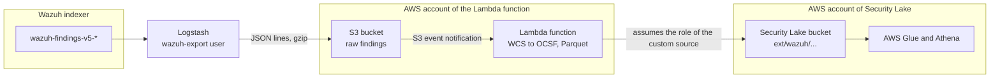

# Amazon Security Lake integration

Exports the Wazuh findings to Amazon Security Lake, as a custom source of OCSF Detection Findings. Read [Integrations](index.md) first: it describes the export window and the settings shared by every integration.

Amazon Security Lake receives **findings only**: the `wazuh-findings-v5-*` data streams, or custom data streams of findings. Events add no value in Security Lake and would only increase its volume and cost: the pipeline drops any document read from an events data stream.

## Architecture

<!-- TODO: add a diagram of the architecture with the AWS service icons, drawn with the 5.x wording (findings, not events), together with its editable source (.drawio or .svg). -->



1. Logstash reads the findings from the Wazuh indexer and writes them, as gzip-compressed JSON lines, to an S3 bucket, under one prefix per source and day: `findings/<category>/<YYYYMMDD>/`.
2. Every new file triggers the Lambda function, which converts its findings into OCSF Detection Findings, and writes them in Parquet into the location of the Wazuh custom source in the Security Lake bucket: `ext/<source>/region=<region>/accountId=<account>/eventDay=<YYYYMMDD>/`.
3. Security Lake catalogs the files in AWS Glue: query them with Amazon Athena, or any subscriber of Security Lake.

The Lambda function can run in the account of Security Lake or in another one. In another account, it writes with the role that Security Lake creates for the custom source.

## Prerequisites

- Wazuh indexer 5.0.0, and a read-only user to export with (see [Security](index.md#security)).
- Amazon Security Lake enabled, in the region to send the findings to.
- Logstash, of a version in the [compatibility matrix](index.md#compatibility), with the `logstash-input-opensearch` plugin. The `s3` output is bundled.
- The `integrations` folder of the same version as the Wazuh indexer (see [Integrations](index.md)), Docker, `make` and `zip`, to build the package of the Lambda function.

## 1. Create the custom source

In the account of Security Lake, from **Security Lake** > **Custom sources** > **Create custom source**:

- **Data source name**: `wazuh`.
- **OCSF event class**: `Detection Finding`.
- **AWS account ID** and **External ID**: the account the Lambda function runs in, and an external ID of your choice.
- **Service access**: a role that allows Security Lake to invoke AWS Glue.

Security Lake creates the location of the source in its bucket, and an IAM role that the account of the function can assume, with the external ID, to write there. Note:

- The bucket, for example `aws-security-data-lake-us-east-1-xxxxxxxxxxxx`.
- The location of the source under `ext/`, for example `wazuh` or `wazuh/1.0`.
- The ARN of the role of the source.

<!-- TODO: add screenshots taken during the test on a real AWS account (docs/img/integrations/): the "Create custom data source" form with the Detection Finding class, and the list of custom sources with the Location and the Provider role ARN of the Wazuh source. -->

## 2. Create the bucket of the raw findings

In the account of the function, create an S3 bucket for Logstash to write to, for example `wazuh-findings-raw`, in the region of Security Lake, with default encryption. The function reads every file once, so a lifecycle rule that expires the objects after a few days keeps the bucket small.

## 3. Create the Lambda function

Build the package of the function, from `integrations/amazon-security-lake`:

```bash
make
```

The package, `wazuh_to_amazon_security_lake.zip`, holds the function and its dependencies, about 45 MB: upload it from the console, or from S3. boto3 is not in it: the Lambda runtime provides it. Create the function with it:

- **Runtime**: Python 3.12, architecture x86_64.
- **Handler**: `lambda_function.lambda_handler`.
- **Memory** and **timeout**: 512 MB and 5 minutes are enough for files of the default size (5 MB).

Set its environment variables:

| Variable | Description |
| --- | --- |
| `AWS_BUCKET` | Security Lake bucket. |
| `SOURCE_LOCATION` | Location of the custom source under `ext/`, as Security Lake shows it: `wazuh` or `wazuh/1.0`. |
| `ACCOUNT_ID` | Account of the custom source: the account ID given when creating it. |
| `REGION` | Region of Security Lake. |
| `ROLE_ARN` | ARN of the role of the custom source. Without it, the function writes with its own role. |
| `EXTERNAL_ID` | External ID of that role. |
| `S3_BUCKET_OCSF` | Optional: a bucket to also write the findings to, as OCSF JSON, for debugging. |

Give the execution role of the function:

- `AWSLambdaBasicExecutionRole`, for its logs.
- `s3:GetObject` on the raw bucket.
- `sts:AssumeRole` on the role of the custom source.
- `s3:PutObject` on the OCSF bucket, if set.

```json
{
  "Version": "2012-10-17",
  "Statement": [
    { "Effect": "Allow", "Action": "s3:GetObject", "Resource": "arn:aws:s3:::wazuh-findings-raw/*" },
    { "Effect": "Allow", "Action": "sts:AssumeRole", "Resource": "<ARN of the role of the custom source>" }
  ]
}
```

## 4. Trigger the function

<!-- TODO: add a screenshot of the S3 trigger of the function taken during the test on a real AWS account: All object create events, with no suffix filter (the files end in .txt.gz). -->

On the raw bucket, add an event notification for **All object create events** (`s3:ObjectCreated:*`), with the function as destination. A failed invocation is retried: the function writes the same output file again, so a retry never duplicates findings.

## 5. Configure Logstash

Give Logstash credentials allowed to write to the raw bucket only: an IAM role of the host (EC2 instance profile, ECS task role), or the access keys of a user, in the environment of the service (`AWS_ACCESS_KEY_ID`, `AWS_SECRET_ACCESS_KEY`).

```json
{
  "Version": "2012-10-17",
  "Statement": [
    { "Effect": "Allow", "Action": ["s3:PutObject", "s3:AbortMultipartUpload"], "Resource": "arn:aws:s3:::wazuh-findings-raw/*" }
  ]
}
```

Install the input plugin:

```bash
/usr/share/logstash/bin/logstash-plugin install --version 1.0.0 logstash-input-opensearch
```

Copy the pipeline files to a folder of their own, in this order:

```bash
mkdir -p /etc/logstash/wazuh
cp integrations/logstash/pipeline/wazuh-indexer-input.conf /etc/logstash/wazuh/10-wazuh-indexer-input.conf
cp integrations/logstash/pipeline/wazuh-source.conf /etc/logstash/wazuh/20-wazuh-source.conf
cp integrations/amazon-security-lake/logstash/pipeline/indexer-to-s3.conf /etc/logstash/wazuh/40-indexer-to-s3.conf
```

Declare the pipeline in `/etc/logstash/pipelines.yml`, with a persisted queue. The pipeline is tested with ECS compatibility disabled:

```yaml
- pipeline.id: wazuh-security-lake
  path.config: "/etc/logstash/wazuh/*.conf"
  pipeline.ecs_compatibility: disabled
  queue.type: persisted
  queue.max_bytes: 4gb
```

Set the settings of the pipeline in the environment of the Logstash service. Set `WAZUH_EXPORT_INDICES` to the findings data streams: its default also reads events, which this pipeline drops. Besides the [shared settings](index.md#settings), the output reads:

| Setting | Default | Description |
| --- | --- | --- |
| `S3_BUCKET_RAW` | **required** | Raw bucket. |
| `AWS_REGION` | **required** | Region of the raw bucket. |
| `AWS_ENDPOINT` | **required** | S3 endpoint of that region, `https://s3.<region>.amazonaws.com`. |
| `S3_TIME_FILE` | `5` | Minutes Logstash collects findings in a file before uploading it. |
| `S3_TEMPORARY_DIRECTORY` | `/usr/share/logstash/data/s3-temp` | Directory of the files not uploaded yet, on persistent storage, for example `/var/lib/logstash/s3-temp`. They are uploaded when Logstash starts again. |

Restart Logstash.

## 6. Validate

After the delay of the export (5 minutes by default) and `S3_TIME_FILE`, the raw bucket holds files under `findings/`, the logs of the function in Amazon CloudWatch show the findings it converted, and the location of the source holds Parquet files:

```bash
aws s3 ls --recursive s3://<Security Lake bucket>/ext/<source location>/
```

<!-- TODO: add a screenshot of the Athena query below, taken during the test on a real AWS account. -->

Once Security Lake has catalogued them, query them from Athena, in the table of the custom source in the Security Lake database of AWS Glue:

```sql
SELECT from_unixtime(time / 1000) AS time, severity, finding_info.title, metadata.log_name
FROM <table of the custom source>
ORDER BY time DESC
LIMIT 10;
```

## OCSF mapping

Every finding becomes an OCSF 1.1.0 [Detection Finding](https://schema.ocsf.io/1.1.0/classes/detection_finding) (class 2004, activity Create):

| OCSF attribute | WCS field or value |
| --- | --- |
| `time`, `finding_info.created_time` | `@timestamp`, in milliseconds |
| `metadata.original_time` | `event.start` |
| `metadata.uid`, `finding_info.uid` | Id of the finding in the Wazuh indexer |
| `metadata.log_name` | Data stream of the finding, for example `wazuh-findings-v5-security` |
| `metadata.product` | `Wazuh` |
| `message`, `finding_info.title` | `wazuh.rule.title`, or `wazuh.rule.name` |
| `finding_info.desc` | `wazuh.rule.description` |
| `finding_info.types` | `wazuh.rule.category` |
| `finding_info.analytic` | `wazuh.rule.id`, `wazuh.rule.name`, `wazuh.rule.description`, `wazuh.rule.category`, `wazuh.rule.version` (type Rule) |
| `finding_info.attacks` | `wazuh.rule.mitre.*`: one attack per technique, with its tactic and sub-techniques |
| `severity_id`, `severity` | `wazuh.rule.level`: informational 1, low 2, medium 3, high 4, critical 5 |
| `status_id`, `status` | `wazuh.case.status`: no case is New (1), active and acknowledged are In Progress (2), completed is Resolved (4), any other status is Other (99) |
| `resources` | `wazuh.agent.id`, `wazuh.agent.name` (type Host) |
| `evidences` | `source.ip`, `source.port`, `destination.ip`, `destination.port`, `process.name`, `process.pid`, `process.command_line`, `file.name`, `file.path`, `user.name`, `user.id` |
| `observables` | The agent name, `source.ip`, `destination.ip` and `user.name` |
| `cloud` | `cloud.provider`, `cloud.region`, `cloud.account.id` (profile `cloud`) |
| `raw_data` | `event.original` |
| `unmapped` | Every other field of the finding, under its WCS name: lists and objects as JSON |

No field of a finding is lost: the WCS fields without an OCSF attribute, such as the compliance requirements of the rule (`wazuh.rule.compliance.*`), the integration (`wazuh.integration.*`), the case (`wazuh.case.*`) or the fields of the event that matched, are kept in `unmapped`, for example `unmapped['wazuh.rule.compliance.pci_dss']`.

Every Parquet file has the same columns, whatever attributes its findings carry: the attributes a finding does not have are null.

## Troubleshooting

| Symptom | Cause and solution |
| --- | --- |
| No file in the raw bucket, and the Logstash log shows `security_exception` from the Wazuh indexer | The export user cannot read the data streams in `WAZUH_EXPORT_INDICES`. Add them to its role. |
| No file in the raw bucket, and the Logstash log shows `AccessDenied` | The credentials of Logstash cannot write to the raw bucket. |
| Files in the raw bucket, none in Security Lake | The event notification does not invoke the function, or the function fails: see its logs in CloudWatch. |
| `AccessDenied` on `AssumeRole` in the logs of the function | The account or the external ID differ from those of the custom source, or the execution role lacks `sts:AssumeRole`. |
| `AccessDenied` on `PutObject` in the logs of the function | `SOURCE_LOCATION` differs from the location of the custom source. |
| `is not a finding` warnings in the logs of the function | The file holds documents without `wazuh.rule`: `WAZUH_EXPORT_INDICES` names a custom data stream of events. |
| Findings missing, compared with the Wazuh indexer | Findings were indexed after the run that read their window. Raise `WAZUH_EXPORT_DELAY` above the detector interval (see [The delay](index.md#the-delay)), and export the range again (see [Interruptions](index.md#interruptions)). |
