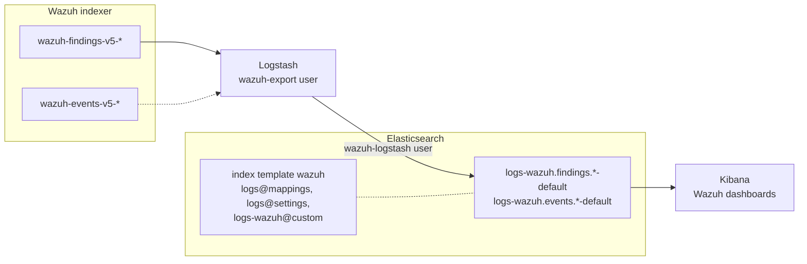

# Elasticsearch integration

Exports the Wazuh findings and events from the Wazuh indexer to Elasticsearch data streams, through Logstash, with the Kibana dashboards to explore them. Read [Integrations](index.md) first: it describes what is exported, the export window and the settings shared by every integration.

## Architecture



Every source data stream is written to its own Elasticsearch data stream (see [Destination of every source](index.md#destination-of-every-source)). The `wazuh` index template maps the WCS fields of all of them.

## Prerequisites

- Wazuh indexer 5.0.0, and a read-only user to export with (see [Security](index.md#security)).
- Elasticsearch and Kibana, of a version in the [compatibility matrix](index.md#compatibility).
- Logstash, with the `logstash-input-opensearch` plugin to read the Wazuh indexer. The `elasticsearch` output is bundled.
- The `integrations` folder of the same version as the Wazuh indexer (see [Integrations](index.md)).

The commands below use `ca.crt` for the CA certificate of Elasticsearch, and `root-ca.pem` for that of the Wazuh indexer.

## 1. Prepare Elasticsearch

Run these steps as an Elasticsearch administrator.

Install the index template of the `logs-wazuh.*-*` data streams. It maps the WCS fields, and gives the data streams the built-in `logs` lifecycle policy: they roll over at 30 days or 50 GB per primary shard, and no data is deleted. Elasticsearch creates them in the `logsdb` index mode, which it applies to every `logs-*-*` data stream to reduce storage.

```bash
curl --cacert ca.crt -u elastic -X PUT "https://<elasticsearch>:9200/_index_template/wazuh" \
  -H 'Content-Type: application/json' -d @integrations/elastic/templates/wazuh-index-template.json
```

### Retention and other settings

Every upgrade of the integration installs the template again. To change its settings or mappings, create the `logs-wazuh@custom` component template instead: the template uses it when it exists, and it is kept across upgrades. For example, to delete the data 90 days after it rolls over, create a lifecycle policy and select it there:

```bash
curl --cacert ca.crt -u elastic -X PUT "https://<elasticsearch>:9200/_ilm/policy/wazuh-90-days" \
  -H 'Content-Type: application/json' -d '{
  "policy": {
    "phases": {
      "hot": { "actions": { "rollover": { "max_age": "30d", "max_primary_shard_size": "50gb" } } },
      "delete": { "min_age": "90d", "actions": { "delete": {} } }
    }
  }
}'
curl --cacert ca.crt -u elastic -X PUT "https://<elasticsearch>:9200/_component_template/logs-wazuh@custom" \
  -H 'Content-Type: application/json' -d '{"template": {"settings": {"index.lifecycle.name": "wazuh-90-days"}}}'
```

The change applies to the backing indices created after it. To apply it to the current ones at once, roll over every data stream: `POST <data stream>/_rollover`.

### Writer user

Create the role and the user Logstash writes with. `create_doc` appends documents, and `auto_configure` creates the data streams on their first document:

```bash
curl --cacert ca.crt -u elastic -X PUT "https://<elasticsearch>:9200/_security/role/wazuh-logstash-writer" \
  -H 'Content-Type: application/json' -d '{
  "description": "Write the Wazuh events and findings exported by Logstash",
  "cluster": ["monitor"],
  "indices": [{ "names": ["logs-wazuh.*-*"], "privileges": ["create_doc", "auto_configure"] }]
}'
curl --cacert ca.crt -u elastic -X PUT "https://<elasticsearch>:9200/_security/user/wazuh-logstash" \
  -H 'Content-Type: application/json' -d '{"password": "<password>", "roles": ["wazuh-logstash-writer"]}'
```

## 2. Configure Logstash

Install the input plugin:

```bash
/usr/share/logstash/bin/logstash-plugin install --version 1.0.0 logstash-input-opensearch
```

Copy the pipeline files to a folder of their own, in this order:

```bash
mkdir -p /etc/logstash/wazuh
cp integrations/logstash/pipeline/wazuh-indexer-input.conf /etc/logstash/wazuh/10-wazuh-indexer-input.conf
cp integrations/logstash/pipeline/wazuh-source.conf /etc/logstash/wazuh/20-wazuh-source.conf
cp integrations/logstash/pipeline/wazuh-data-stream.conf /etc/logstash/wazuh/30-wazuh-data-stream.conf
cp integrations/elastic/logstash/pipeline/indexer-to-elastic.conf /etc/logstash/wazuh/40-indexer-to-elastic.conf
```

Declare the pipeline in `/etc/logstash/pipelines.yml`, with a persisted queue and the dead letter queue. The pipeline is tested with ECS compatibility disabled:

```yaml
- pipeline.id: wazuh-elastic
  path.config: "/etc/logstash/wazuh/*.conf"
  pipeline.ecs_compatibility: disabled
  queue.type: persisted
  queue.max_bytes: 4gb
  dead_letter_queue.enable: true
```

Set the settings of the pipeline in the environment of the Logstash service, and the secrets in the Logstash keystore (see [TLS and credentials](index.md#tls-and-credentials)). Besides the [shared settings](index.md#settings), the output reads:

| Setting | Default | Description |
| --- | --- | --- |
| `ELASTIC_HOST` | **required** | Elasticsearch URL, `https://<elasticsearch>:9200`, or several separated by spaces. On Elastic Cloud, the Elasticsearch endpoint of the deployment, on port 443. |
| `ELASTIC_USERNAME` | **required** | User Logstash writes with, `wazuh-logstash` above. |
| `ELASTIC_PASSWORD` | **required** | Password of that user. |
| `ELASTIC_CA` | **required** | CA certificate of Elasticsearch. |

Restart Logstash.

## 3. Import the dashboards

Import [`elastic/dashboards.ndjson`](https://github.com/wazuh/wazuh-indexer-plugins/blob/main/integrations/elastic/dashboards.ndjson) in Kibana, from **Stack Management** > **Saved objects** > **Import**, or with the API:

```bash
curl --cacert ca.crt -u elastic -X POST "https://<kibana>:5601/api/saved_objects/_import?overwrite=true" \
  -H 'kbn-xsrf: true' --form file=@integrations/elastic/dashboards.ndjson
```

It holds the `logs-wazuh.findings.*-*` and `logs-wazuh.events.*-*` data views, four dashboards (**Findings overview**, **MITRE ATT&CK**, **Compliance** and **Events overview**) and the **Latest findings** saved search. The API imports them into the default space: to import them into another one, use `https://<kibana>:5601/s/<space>/api/saved_objects/_import`.

## 4. Validate

After the delay of the export (5 minutes by default) and one more minute, the Wazuh data streams exist:

```bash
curl --cacert ca.crt -u elastic "https://<elasticsearch>:9200/_data_stream/logs-wazuh.*?filter_path=data_streams.name"
```

Compare the count of a closed time range with the source, for example the findings of an hour that ended more than the delay ago:

```bash
range='{"query":{"range":{"@timestamp":{"gte":"2026-10-22T08:00:00Z","lt":"2026-10-22T09:00:00Z"}}}}'
curl --cacert root-ca.pem -u wazuh-export "https://<indexer>:9200/wazuh-findings-v5-*/_count" -H 'Content-Type: application/json' -d "$range"
curl --cacert ca.crt -u elastic "https://<elasticsearch>:9200/logs-wazuh.findings.*-*/_count" -H 'Content-Type: application/json' -d "$range"
```

## Troubleshooting

| Symptom | Cause and solution |
| --- | --- |
| No data stream is created, and the Logstash log shows `security_exception` from the Wazuh indexer | The export user cannot read the data streams in `WAZUH_EXPORT_INDICES`. Add them to its role. |
| `security_exception` from Elasticsearch | The writer role lacks `create_doc` or `auto_configure` on `logs-wazuh.*-*`, or the data stream namespace is outside that pattern. |
| Findings missing at the destination, events present | Findings were indexed after the run that read their window. Raise `WAZUH_EXPORT_DELAY` above the detector interval (see [The delay](index.md#the-delay)), and export the range again (see [Interruptions](index.md#interruptions)). |
| Documents in the dead letter queue | Elasticsearch rejected them, for example a field mapped with another type in `logs-wazuh@custom`. Inspect them with the [`dead_letter_queue` input](https://www.elastic.co/docs/reference/logstash/plugins/plugins-inputs-dead_letter_queue). |
| `version_conflict_engine_exception` | Not an error: a document read twice, by a backfill or after a restart, is dropped as a duplicate. The output does not log it. |
| Dashboards empty | Check the time range of the dashboard against the data, and the data views against the data stream names (a custom `WAZUH_EXPORT_NAMESPACE` still matches `logs-wazuh.findings.*-*`). |
