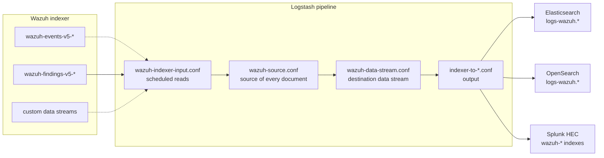

# Integrations

The integrations export the data of the Wazuh indexer to third-party platforms. A Logstash pipeline reads the events and findings data streams of the [Wazuh Common Schema](../modules/setup/schema.md) (WCS), and delivers them to:

- [Elasticsearch](elastic.md)
- [OpenSearch](opensearch.md)
- [Splunk](splunk.md)

The integrations live in the [`integrations`](https://github.com/wazuh/wazuh-indexer-plugins/tree/main/integrations) folder of the repository. Get the folder of the same version as the Wazuh indexer, for example:

```bash
git clone --depth 1 --branch v5.0.0 https://github.com/wazuh/wazuh-indexer-plugins.git
cd wazuh-indexer-plugins
```

The commands of these pages run from that folder.

**The [Amazon Security Lake](https://github.com/wazuh/wazuh-indexer-plugins/tree/main/integrations/amazon-security-lake) integration has not been adapted to Wazuh 5.x yet.**

## Architecture



Every integration is one Logstash pipeline made of the following files, in this order. The first two are shared by all of them:

| File | Purpose |
| --- | --- |
| `integrations/logstash/pipeline/wazuh-indexer-input.conf` | Reads the documents to export from the Wazuh indexer, on a schedule. |
| `integrations/logstash/pipeline/wazuh-source.conf` | Identifies the source of every document (events, findings or custom, and its category). |
| `integrations/logstash/pipeline/wazuh-data-stream.conf` | Elasticsearch and OpenSearch only: names the destination data stream of every document. |
| `<integration>/logstash/pipeline/indexer-to-<integration>.conf` | Writes the documents to the destination. |

The pipelines read every setting from the environment or from the [Logstash keystore](https://www.elastic.co/docs/reference/logstash/keystore): no pipeline file needs editing to deploy an integration.

## What is exported

By default, the findings and events data streams: `wazuh-findings-v5-*,wazuh-events-v5-*`. The `WAZUH_EXPORT_INDICES` setting selects others, as a comma-separated list of data stream names or patterns:

| Scenario | `WAZUH_EXPORT_INDICES` |
| --- | --- |
| Findings and events (default) | `wazuh-findings-v5-*,wazuh-events-v5-*` |
| Findings only | `wazuh-findings-v5-*` |
| Events only | `wazuh-events-v5-*` |
| Custom data streams | Their names or patterns, alone or with the above, e.g. `wazuh-findings-v5-*,my-stream` |

The read-only user that Logstash exports with must be allowed to read every data stream in the list (see [Security](#security)).

> **Findings embed their event.** A finding is a copy of the event that matched a rule, plus the rule (`wazuh.rule.*`) and a reference to the event (`event.doc_id`, `event.index`). Exporting events as well as findings stores every matched event twice at the destination, which costs storage and, on platforms licensed by volume, license. Export events only if the destination needs the events that matched no rule.

Documents are exported as they are stored in the Wazuh indexer: WCS documents. The Elasticsearch and OpenSearch integrations add the `data_stream` fields that name the destination data stream.

### Destination of every source

The destination keeps every source apart:

| Source | Elasticsearch and OpenSearch data stream | Splunk index, sourcetype and source |
| --- | --- | --- |
| `wazuh-findings-v5-<category>` | `logs-wazuh.findings.<category>-<namespace>` | `wazuh-findings`, `wazuh:findings`, the data stream |
| `wazuh-events-v5-<category>` | `logs-wazuh.events.<category>-<namespace>` | `wazuh-events`, `wazuh:events`, the data stream |
| Any other data stream | `logs-wazuh.custom.<data stream>-<namespace>` | `wazuh-custom`, `wazuh:custom`, the data stream |

## Export window

Logstash reads the Wazuh indexer on a schedule, with a search. Events and findings are stored in data streams, which are append-only, so every run reads the documents whose `@timestamp` falls in a time window:

```
[now - WAZUH_EXPORT_DELAY - WAZUH_EXPORT_LOOKBACK, now - WAZUH_EXPORT_DELAY)
```

Both ends are rounded down to the minute. With the defaults, a run every minute reading one minute, five minutes behind the current time, consecutive runs read consecutive windows and every document is read once.

```mermaid
gantt
    dateFormat HH:mm
    axisFormat %H:%M
    section Run at 10:06
    Window read :a1, 10:00, 1m
    Delay       :after a1, 5m
    section Run at 10:07
    Window read :b1, 10:01, 1m
    Delay       :after b1, 5m
```



### The delay

`@timestamp` is the time the Wazuh Engine received the event, and a finding carries the `@timestamp` of its event (see [Time fields](../modules/setup/schema.md)). The detectors of Ruleset Management, however, write findings on their own schedule: every `plugins.content_manager.security_analytics.detector_interval` minutes, 2 by default (see the [Content Manager configuration](../modules/content-manager/configuration.md)). A finding is therefore indexed up to one detector interval, plus the time the detector run takes, after its `@timestamp`.

A document indexed after the run that reads its window is never exported by the schedule. Keep:

```
WAZUH_EXPORT_DELAY > longest detector interval + detector run time + refresh interval
```

The default delay, 5 minutes, covers the default detector interval with a margin. Raise it with the detector interval, or when the detectors run behind under load. The delay is also the latency of the export: a document is read between `WAZUH_EXPORT_DELAY` and `WAZUH_EXPORT_DELAY + WAZUH_EXPORT_LOOKBACK` after its `@timestamp`.

### Interruptions

The export keeps no checkpoint: while Logstash or the Wazuh indexer is down, the windows of the missed runs are not exported. To export a missed range, run `wazuh-indexer-backfill.conf` once in place of `wazuh-indexer-input.conf`, with the range in `WAZUH_BACKFILL_FROM` and `WAZUH_BACKFILL_TO` (ISO 8601, UTC).

### Duplicates

- **Elasticsearch and OpenSearch** use the id of the source document as the id of the exported one, and drop a document they already have: reading a window twice, by a backfill or after a restart, adds nothing. The check covers the backing index the document is in: a copy written after the destination data stream rolled over is accepted as a new document.
- **Splunk** keeps every copy it receives. Give a backfill only the missing range. Every event carries the id of its source document as the `wazuh_document_id` indexed field, to remove the copies at search time: `` `wazuh_findings` | dedup wazuh_document_id ``.

## Security

The integrations need two users, one on each side, and neither needs administrator privileges: the Wazuh indexer user below, and the destination user that the page of every integration creates. Logstash connects to the Wazuh indexer on port 9200, and to the destination on its own port (9200 for Elasticsearch and OpenSearch, 8088 for the Splunk HTTP Event Collector).

### Wazuh indexer

Logstash reads the Wazuh indexer with a read-only user. As a Wazuh indexer user allowed to manage security, create a role allowed to search the exported data streams, then a user mapped to it, for example with the [security REST API](../security/defining-users-and-roles.md):

```bash
curl --cacert root-ca.pem -u admin -X PUT "https://<indexer>:9200/_plugins/_security/api/roles/wazuh-export" \
  -H 'Content-Type: application/json' -d '{
  "description": "Read-only access to export the Wazuh events and findings data streams",
  "cluster_permissions": ["cluster:monitor/main", "indices:data/read/scroll", "indices:data/read/scroll/clear"],
  "index_permissions": [
    { "index_patterns": ["wazuh-events-v5-*", "wazuh-findings-v5-*"], "allowed_actions": ["read"] }
  ]
}'
curl --cacert root-ca.pem -u admin -X PUT "https://<indexer>:9200/_plugins/_security/api/internalusers/wazuh-export" \
  -H 'Content-Type: application/json' -d '{"password": "<password>"}'
curl --cacert root-ca.pem -u admin -X PUT "https://<indexer>:9200/_plugins/_security/api/rolesmapping/wazuh-export" \
  -H 'Content-Type: application/json' -d '{"users": ["wazuh-export"]}'
```

Add the custom data streams to export to `index_patterns`.

### TLS and credentials

All the connections use TLS, verified against the CA certificate of every side (`WAZUH_INDEXER_CA`, `ELASTIC_CA`, `OPENSEARCH_CA`, `SPLUNK_CA`). When a side has a certificate from a public certificate authority, such as Elastic Cloud, set its setting to the CA bundle of the operating system, for example `/etc/ssl/certs/ca-certificates.crt`.

Keep the passwords and the HEC token in the [Logstash keystore](https://www.elastic.co/docs/reference/logstash/keystore), not in the environment.

## Settings

Settings of the shared pipeline files. Every integration page lists the settings of its output. Set them in the environment of the Logstash service, `/etc/default/logstash` (Debian, Ubuntu) or `/etc/sysconfig/logstash` (Red Hat), and the secrets in the keystore.

The settings marked **required** have defaults that only fit the development environments of the repository: set them in every deployment.

| Setting | Default | Description |
| --- | --- | --- |
| `WAZUH_INDEXER_HOST` | **required** | Wazuh indexer node, `host:port`. One node: to spread the reads over a cluster, point it to a load balancer, or list the nodes in `hosts` of `wazuh-indexer-input.conf`. |
| `WAZUH_INDEXER_USERNAME` | **required** | Read-only user Logstash exports with. |
| `WAZUH_INDEXER_PASSWORD` | **required** | Password of that user. |
| `WAZUH_INDEXER_CA` | **required** | CA certificate of the Wazuh indexer. |
| `WAZUH_EXPORT_INDICES` | `wazuh-findings-v5-*,wazuh-events-v5-*` | Data streams or patterns to export, comma-separated. |
| `WAZUH_EXPORT_LOOKBACK` | `1m` | Length of the window every run reads. Keep it equal to the interval of the schedule. |
| `WAZUH_EXPORT_DELAY` | `5m` | How far behind the current time the window ends. See [The delay](#the-delay). |
| `WAZUH_EXPORT_SCHEDULE` | `* * * * *` | Cron schedule of the runs. |
| `WAZUH_EXPORT_NAMESPACE` | `default` | Elasticsearch and OpenSearch: namespace of the destination data streams. |
| `WAZUH_BACKFILL_FROM`, `WAZUH_BACKFILL_TO` | | `wazuh-indexer-backfill.conf` only: the time range to read, ISO 8601. |

## Sizing

- **Logstash.** The integrations are tested with a 1 GB heap and the default workers and batch size. Size the persisted queue (`queue.max_bytes`) for the longest destination outage to ride out: export rate × outage duration.
- **Destination.** Every exported document is written once. Exporting findings and events stores every matched event twice: see [What is exported](#what-is-exported).

### Several integrations

To export to several destinations, run one pipeline per integration, each in a folder of its own and with its own `pipeline.id` in `pipelines.yml`. Every pipeline reads the Wazuh indexer on its own: the reads add up.

## Monitoring

The Logstash monitoring API reports every pipeline: the documents read and written, and the documents waiting in the queue.

```bash
curl -s "http://localhost:9600/_node/stats/pipelines/<pipeline id>?pretty"
```

- `events.in` and `events.out` grow with every run. If `events.in` stops growing, the runs fail: the Logstash log shows the error of the input `wazuh-indexer`.
- `queue.events_count` grows while the destination does not accept documents.

## Upgrading

Upgrade the integration with every upgrade of the Wazuh indexer, from the folder of the new version:

1. Install the index template and, for OpenSearch, the ISM policy again, as described in the page of the integration. A new template applies to the backing indices created after it: roll over every data stream to apply it at once, with `POST <data stream>/_rollover`.
2. Replace the pipeline files, and restart Logstash.
3. Import the dashboards again, with `overwrite=true`, or install the new package of the Splunk app (`splunk install app wazuh_integration.tgz -update 1`).

## Compatibility

| Wazuh indexer | Logstash | Elasticsearch | OpenSearch | Splunk |
| --- | --- | --- | --- | --- |
| 5.0.0 | 8.19.23 | 9.5.4 | 3.9.0 | 10.6.0 |

