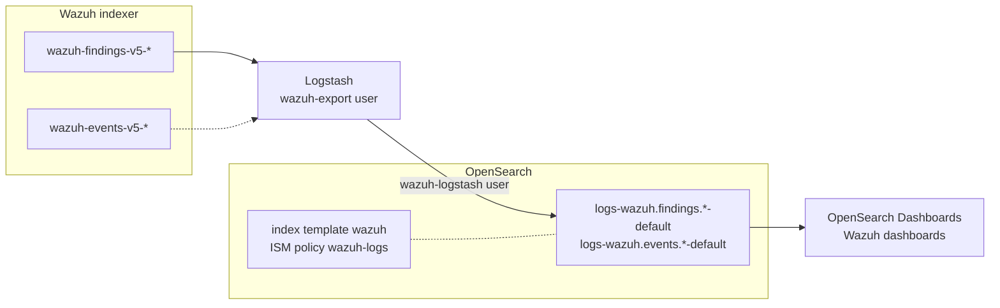

# OpenSearch integration

Exports the Wazuh findings and events from the Wazuh indexer to the data streams of another OpenSearch cluster, through Logstash, with the OpenSearch Dashboards dashboards to explore them. Read [Integrations](index.md) first: it describes what is exported, the export window and the settings shared by every integration.

## Architecture



Every source data stream is written to its own OpenSearch data stream (see [Destination of every source](index.md#destination-of-every-source)). The `wazuh` index template maps the WCS fields of all of them, and the `wazuh-logs` Index State Management (ISM) policy rolls them over.

## Prerequisites

- Wazuh indexer 5.0.0, and a read-only user to export with (see [Security](index.md#security)).
- OpenSearch and OpenSearch Dashboards, of a version in the [compatibility matrix](index.md#compatibility), with the security plugin.
- Logstash, with the `logstash-input-opensearch` and `logstash-output-opensearch` plugins.
- The `integrations` folder of the same version as the Wazuh indexer (see [Integrations](index.md)).

The commands below use `opensearch-ca.pem` for the CA certificate of the destination OpenSearch cluster, and `root-ca.pem` for that of the Wazuh indexer.

## 1. Prepare OpenSearch

Run these steps as an OpenSearch administrator.

Install the index template of the `logs-wazuh.*-*` data streams:

```bash
curl --cacert opensearch-ca.pem -u admin -X PUT "https://<opensearch>:9200/_index_template/wazuh" \
  -H 'Content-Type: application/json' -d @integrations/opensearch/templates/wazuh-index-template.json
```

Install the Index State Management (ISM) policy. It applies to the backing indices of `logs-wazuh.*-*` created after it, and rolls them over at 30 days or 50 GB per primary shard. It deletes nothing.

```bash
curl --cacert opensearch-ca.pem -u admin -X PUT "https://<opensearch>:9200/_plugins/_ism/policies/wazuh-logs" \
  -H 'Content-Type: application/json' -d @integrations/opensearch/templates/wazuh-ism-policy.json
```

To install it again, for example on an upgrade, OpenSearch needs the current version of the policy: get `_seq_no` and `_primary_term` with `GET _plugins/_ism/policies/wazuh-logs`, and add `?if_seq_no=<_seq_no>&if_primary_term=<_primary_term>` to the request.

### Retention

Every upgrade of the integration installs the `wazuh-logs` policy again. To delete data, create a policy of your own instead, with a higher `ism_template` priority than `wazuh-logs` (200), so that it takes over the new backing indices. For example, to delete them 90 days after they roll over:

```bash
curl --cacert opensearch-ca.pem -u admin -X PUT "https://<opensearch>:9200/_plugins/_ism/policies/wazuh-logs-90-days" \
  -H 'Content-Type: application/json' -d '{
  "policy": {
    "description": "Rolls over the Wazuh data streams and deletes their indices 90 days after rollover",
    "default_state": "hot",
    "states": [
      {
        "name": "hot",
        "actions": [{ "rollover": { "min_index_age": "30d", "min_primary_shard_size": "50gb" } }],
        "transitions": [{ "state_name": "delete", "conditions": { "min_rollover_age": "90d" } }]
      },
      { "name": "delete", "actions": [{ "delete": {} }], "transitions": [] }
    ],
    "ism_template": [{ "index_patterns": ["logs-wazuh.*-*"], "priority": 300 }]
  }
}'
```

The backing indices that already exist keep their policy. Move them to the new one with `POST _plugins/_ism/change_policy/.ds-logs-wazuh*` and `{"policy_id": "wazuh-logs-90-days"}`.

### Writer user

Create the role and the user Logstash writes with, allowed to create the data streams, append to them, and add the mappings of the fields that appear for the first time. The security plugin rejects the writes without any of the actions of the role.

```bash
curl --cacert opensearch-ca.pem -u admin -X PUT "https://<opensearch>:9200/_plugins/_security/api/roles/wazuh-logstash-writer" \
  -H 'Content-Type: application/json' -d '{
  "description": "Write the Wazuh events and findings exported by Logstash",
  "cluster_permissions": ["cluster:monitor/main", "indices:data/write/bulk"],
  "index_permissions": [
    {
      "index_patterns": ["logs-wazuh.*-*"],
      "allowed_actions": [
        "indices:data/write/index", "indices:data/write/bulk*",
        "indices:admin/create", "indices:admin/data_stream/create", "indices:admin/mapping/put"
      ]
    }
  ]
}'
curl --cacert opensearch-ca.pem -u admin -X PUT "https://<opensearch>:9200/_plugins/_security/api/internalusers/wazuh-logstash" \
  -H 'Content-Type: application/json' -d '{"password": "<password>"}'
curl --cacert opensearch-ca.pem -u admin -X PUT "https://<opensearch>:9200/_plugins/_security/api/rolesmapping/wazuh-logstash-writer" \
  -H 'Content-Type: application/json' -d '{"users": ["wazuh-logstash"]}'
```

## 2. Configure Logstash

Install the plugins:

```bash
/usr/share/logstash/bin/logstash-plugin install --version 1.0.0 logstash-input-opensearch
/usr/share/logstash/bin/logstash-plugin install --version 2.1.1 logstash-output-opensearch
```

Copy the pipeline files to a folder of their own, in this order:

```bash
mkdir -p /etc/logstash/wazuh
cp integrations/logstash/pipeline/wazuh-indexer-input.conf /etc/logstash/wazuh/10-wazuh-indexer-input.conf
cp integrations/logstash/pipeline/wazuh-source.conf /etc/logstash/wazuh/20-wazuh-source.conf
cp integrations/logstash/pipeline/wazuh-data-stream.conf /etc/logstash/wazuh/30-wazuh-data-stream.conf
cp integrations/opensearch/logstash/pipeline/indexer-to-opensearch.conf /etc/logstash/wazuh/40-indexer-to-opensearch.conf
```

Declare the pipeline in `/etc/logstash/pipelines.yml`, with a persisted queue and the dead letter queue. The pipeline is tested with ECS compatibility disabled:

```yaml
- pipeline.id: wazuh-opensearch
  path.config: "/etc/logstash/wazuh/*.conf"
  pipeline.ecs_compatibility: disabled
  queue.type: persisted
  queue.max_bytes: 4gb
  dead_letter_queue.enable: true
```

Set the settings of the pipeline in the environment of the Logstash service, and the secrets in the Logstash keystore (see [TLS and credentials](index.md#tls-and-credentials)). Besides the [shared settings](index.md#settings), the output reads:

| Setting | Default | Description |
| --- | --- | --- |
| `OPENSEARCH_HOST` | **required** | OpenSearch URL, `https://<opensearch>:9200`, or several separated by spaces. The pipeline authenticates with a user and a password only. |
| `OPENSEARCH_USERNAME` | **required** | User Logstash writes with, `wazuh-logstash` above. |
| `OPENSEARCH_PASSWORD` | **required** | Password of that user. |
| `OPENSEARCH_CA` | **required** | CA certificate of OpenSearch. |

Restart Logstash.

## 3. Import the dashboards

Import [`opensearch/dashboards.ndjson`](https://github.com/wazuh/wazuh-indexer-plugins/blob/main/integrations/opensearch/dashboards.ndjson) in OpenSearch Dashboards, from **Dashboards Management** > **Saved objects** > **Import**, or with the API:

```bash
curl --cacert opensearch-ca.pem -u admin -X POST "https://<dashboards>:5601/api/saved_objects/_import?overwrite=true" \
  -H 'osd-xsrf: true' --form file=@integrations/opensearch/dashboards.ndjson
```

It holds the `logs-wazuh.findings.*-*` and `logs-wazuh.events.*-*` index patterns, and the dashboards of the Wazuh dashboard built on the findings, the same and with the same layout, each one filtered as the Wazuh dashboard filters it:

- **Threat hunting**, **MITRE ATT&CK**, **Malware detection** and **Case management**.
- **Docker**, **AWS**, **Azure**, **Google Cloud**, **GitHub** and **Office**: the findings of each integration, with the drilldowns of GitHub and Office.
- **PCI**, **GDPR**, **HIPAA**, **NIST 800-53**, **NIST 800-171**, **ISO 27001**, **TSC**, **CMMC**, **FedRAMP** and **NIS2**: the findings of the rules of each compliance framework.
- The **Agent dashboard** of each module, which the Wazuh dashboard shows when an agent is pinned: pick the agent in the control on top.
- The **drilldowns** of GitHub and Office, which the Wazuh dashboard shows when a value of a table is clicked: filter for one value (actor, organization, user, IP address...) in the table on top.

Their titles start with `Wazuh - `. The **Wazuh - Events overview** dashboard, of the integration, shows the events. With multi-tenancy enabled, the API imports them into the tenant of the request: add `-H 'securitytenant: global'` to share them with every user.

## 4. Validate

After the delay of the export (5 minutes by default) and one more minute, the Wazuh data streams exist, and their backing indices are managed by the policy:

```bash
curl --cacert opensearch-ca.pem -u admin "https://<opensearch>:9200/_data_stream/logs-wazuh.*?filter_path=data_streams.name"
curl --cacert opensearch-ca.pem -u admin "https://<opensearch>:9200/_plugins/_ism/explain/.ds-logs-wazuh*?filter_path=*.policy_id"
```

Compare the count of a closed time range with the source, as described for [Elasticsearch](elastic.md#4-validate).

## Troubleshooting

| Symptom | Cause and solution |
| --- | --- |
| No data stream is created, and the Logstash log shows `security_exception` from the Wazuh indexer | The export user cannot read the data streams in `WAZUH_EXPORT_INDICES`. Add them to its role. |
| `security_exception` or `no permissions` from OpenSearch | The writer role lacks a permission on `logs-wazuh.*-*`, or the data stream namespace is outside that pattern. |
| A data stream is created as a plain index | The index template was not installed before the first document. Delete the index, install the template, and export the range again (see [Interruptions](index.md#interruptions)). |
| Findings missing at the destination, events present | Findings were indexed after the run that read their window. Raise `WAZUH_EXPORT_DELAY` above the detector interval (see [The delay](index.md#the-delay)), and export the range again (see [Interruptions](index.md#interruptions)). |
| Documents in the dead letter queue | OpenSearch rejected them. Inspect them with the [`dead_letter_queue` input](https://www.elastic.co/docs/reference/logstash/plugins/plugins-inputs-dead_letter_queue). |
| `version_conflict_engine_exception` | Not an error: a document read twice, by a backfill or after a restart, is dropped as a duplicate. The output does not log it. |
