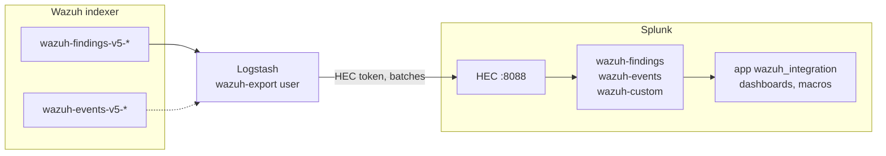

# Splunk integration

Exports the Wazuh findings and events from the Wazuh indexer to Splunk, through Logstash and the HTTP Event Collector (HEC), with a Splunk app that holds the indexes, sourcetypes and dashboards to explore them. Read [Integrations](index.md) first: it describes what is exported, the export window and the settings shared by every integration.

## Architecture



Every document becomes an HEC event, in the index of its kind of source, with the data stream it was read from as its source (see [Destination of every source](index.md#destination-of-every-source)):

| HEC field | Value |
| --- | --- |
| `time` | The `@timestamp` of the document. |
| `host` | The name of the Wazuh agent that collected it (`wazuh.agent.name`), or `wazuh`. |
| `source` | The data stream it was read from, for example `wazuh-findings-v5-security`. |
| `sourcetype` | `wazuh:findings`, `wazuh:events` or `wazuh:custom`. |
| `index` | `wazuh-findings`, `wazuh-events` or `wazuh-custom`, configurable. |
| `fields` | `wazuh_document_id`, the id of the source document, as an indexed field. |
| `event` | The document, whose fields Splunk extracts at search time. |

Logstash sends the events in batches, one HEC request per batch of its pipeline (125 events by default).

## Prerequisites

- Wazuh indexer 5.0.0, and a read-only user to export with (see [Security](index.md#security)).
- Splunk Enterprise, of a version in the [compatibility matrix](index.md#compatibility).
- Logstash, with the `logstash-input-opensearch` plugin to read the Wazuh indexer. The `http` output is bundled.
- The `integrations` folder of the same version as the Wazuh indexer (see [Integrations](index.md)).

The commands below use `splunk-ca.pem` for the CA certificate of Splunk, and `root-ca.pem` for that of the Wazuh indexer.

## 1. Install the Splunk app

The `integrations/splunk/app/wazuh_integration` app holds:

- `indexes.conf`: the `wazuh-findings`, `wazuh-events` and `wazuh-custom` indexes, of up to 500 GB each (`maxTotalDataSizeMB`), with the default retention of Splunk (`frozenTimePeriodInSecs`, about 6 years). Change them in `local/indexes.conf` of the app.
- `props.conf`: the `wazuh:findings`, `wazuh:events` and `wazuh:custom` sourcetypes, which extract the JSON fields of every event at search time.
- `limits.conf`: raises `[kv] maxchars` to 102400. Splunk extracts no field from an event longer than `maxchars`, 10240 characters by default, which findings often exceed. The setting applies to every app.
- `macros.conf`: `` `wazuh_findings` ``, `` `wazuh_events` `` and `` `wazuh_custom` ``, the searches of the dashboards, shared with every app.
- The **Findings overview**, **MITRE ATT&CK**, **Compliance** and **Events overview** dashboards (Dashboard Studio).

Package it and install it, from **Apps** > **Manage Apps** > **Install app from file**, or with the CLI:

```bash
tar -czf wazuh_integration.tgz -C integrations/splunk/app wazuh_integration
/opt/splunk/bin/splunk install app wazuh_integration.tgz -auth admin
/opt/splunk/bin/splunk restart
```

In a distributed deployment, install the indexes on the indexers and the whole app on the search heads.

The settings in `local/` of the app are kept when the app is upgraded. If Logstash writes to other indexes (see the settings below), create them, and override the macros in `local/macros.conf`:

```ini
[wazuh_findings]
definition = index="my-findings" sourcetype="wazuh:findings"
```

## 2. Set up the HTTP Event Collector

Enable HEC with TLS, from **Settings** > **Data inputs** > **HTTP Event Collector** > **Global Settings** (**All Tokens** enabled, **Enable SSL** selected), or with the REST API:

```bash
curl --cacert splunk-ca.pem -u admin -X POST "https://<splunk>:8089/servicesNS/nobody/splunk_httpinput/data/inputs/http/http" \
  -d disabled=0 -d enableSSL=1
```

Logstash verifies the certificate of HEC and its host name. The certificate Splunk installs by default is issued to `SplunkServerDefaultCert`, not to the host name of Splunk, so the connection fails with it: give HEC a certificate issued for the host name in `SPLUNK_HEC_URL` (`serverCert` in the `[http]` stanza of `inputs.conf`).

Create a token allowed to write to the Wazuh indexes only, from **New Token** on the same page, or with the REST API:

```bash
curl --cacert splunk-ca.pem -u admin -X POST "https://<splunk>:8089/servicesNS/nobody/splunk_httpinput/data/inputs/http" \
  -d name=wazuh-logstash -d index=wazuh-findings -d indexes=wazuh-findings,wazuh-events,wazuh-custom
```

The response holds the token. Keep indexer acknowledgment disabled, the default: the `http` output of Logstash does not use it.

## 3. Configure Logstash

Install the input plugin:

```bash
/usr/share/logstash/bin/logstash-plugin install --version 1.0.0 logstash-input-opensearch
```

Copy the pipeline files to a folder of their own, in this order:

```bash
mkdir -p /etc/logstash/wazuh
cp integrations/logstash/pipeline/wazuh-indexer-input.conf /etc/logstash/wazuh/10-wazuh-indexer-input.conf
cp integrations/logstash/pipeline/wazuh-source.conf /etc/logstash/wazuh/20-wazuh-source.conf
cp integrations/splunk/logstash/pipeline/indexer-to-splunk.conf /etc/logstash/wazuh/40-indexer-to-splunk.conf
```

Declare the pipeline in `/etc/logstash/pipelines.yml`, with a persisted queue. The pipeline is tested with ECS compatibility disabled:

```yaml
- pipeline.id: wazuh-splunk
  path.config: "/etc/logstash/wazuh/*.conf"
  pipeline.ecs_compatibility: disabled
  queue.type: persisted
  queue.max_bytes: 4gb
```

Set the settings of the pipeline in the environment of the Logstash service, and the secrets in the Logstash keystore (see [TLS and credentials](index.md#tls-and-credentials)). Keep `WAZUH_EXPORT_LOOKBACK` equal to the interval of `WAZUH_EXPORT_SCHEDULE`, the default: Splunk keeps every copy of a document it receives (see [Duplicates](index.md#duplicates)). Besides the [shared settings](index.md#settings), the output reads:

| Setting | Default | Description |
| --- | --- | --- |
| `SPLUNK_HEC_URL` | **required** | HEC event endpoint, `https://<splunk>:8088/services/collector/event`. One URL: to spread the load over several indexers or heavy forwarders, point it to a load balancer. |
| `SPLUNK_HEC_TOKEN` | **required** | HEC token. |
| `SPLUNK_CA` | **required** | CA certificate of the HEC endpoint. |
| `SPLUNK_INDEX_FINDINGS` | `wazuh-findings` | Index for findings. |
| `SPLUNK_INDEX_EVENTS` | `wazuh-events` | Index for events. |
| `SPLUNK_INDEX_CUSTOM` | `wazuh-custom` | Index for any other data stream. |

Restart Logstash.

## 4. Validate

After the delay of the export (5 minutes by default) and one more minute, the indexes hold events. Compare the count of a closed time range with the source, for example the findings of an hour that ended more than the delay ago:

```
`wazuh_findings` earliest=1792656000 latest=1792659600 | stats count, dc(wazuh_document_id) as unique
```

```bash
curl --cacert root-ca.pem -u wazuh-export "https://<indexer>:9200/wazuh-findings-v5-*/_count" -H 'Content-Type: application/json' \
  -d '{"query":{"range":{"@timestamp":{"gte":"2026-10-22T08:00:00Z","lt":"2026-10-22T09:00:00Z"}}}}'
```

The Splunk search takes the range in epoch seconds (here 2026-10-22 08:00 to 09:00 UTC, from `date -u -d 2026-10-22T08:00:00Z +%s`): a date written as text is read in the time zone of the Splunk user, not in UTC like the Wazuh indexer. `count` and `unique` differ when a document was received twice.

## Troubleshooting

| Symptom | Cause and solution |
| --- | --- |
| No event in Splunk, and the Logstash log shows `security_exception` from the Wazuh indexer | The export user cannot read the data streams in `WAZUH_EXPORT_INDICES`. Add them to its role. |
| The Logstash log shows HTTP 403 or `Invalid token` | The HEC token is wrong or disabled. |
| The Logstash log shows a certificate or host name error | The certificate of HEC is not issued for the host name in `SPLUNK_HEC_URL`, or `SPLUNK_CA` is not its CA. |
| The Logstash log shows HTTP 400 `Incorrect index` | The token is not allowed to write to one of the indexes, or the index does not exist. |
| Events in Splunk without extracted fields | The event is longer than `[kv] maxchars`. Check the effective value with `splunk btool limits list kv --debug`, and that the app is installed on the search heads. |
| Dashboards empty, events present | The indexes differ from those of the macros: override the macros. |
| Findings missing, events present | Findings were indexed after the run that read their window. Raise `WAZUH_EXPORT_DELAY` above the detector interval (see [The delay](index.md#the-delay)), and export the missing range again (see [Interruptions](index.md#interruptions)). |
| Duplicated events | A failed HEC request was sent again, or a backfill overlapped the scheduled export. Remove them at search time with `dedup wazuh_document_id`. |
