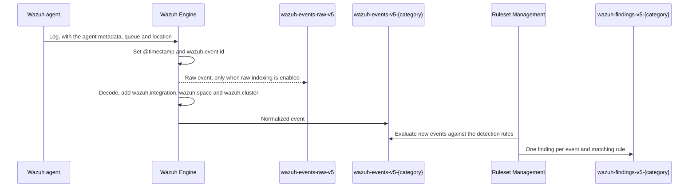

# Wazuh Common Schema

The Wazuh Common Schema (WCS) is the data model of the indices Wazuh writes: events, findings, inventory states, metrics and content. It derives from version 9.1.0 of the [Elastic Common Schema](https://www.elastic.co/docs/reference/ecs/ecs-field-reference) (ECS): it keeps the ECS field names and types, and adds the fields Wazuh needs, most of them under the `wazuh` object.

A field keeps its ECS meaning unless its WCS description says otherwise. Wazuh gives a few ECS fields a specific meaning, the time fields in particular. This page explains them, together with the Wazuh fields that events and findings rely on:

- [Field reference](#field-reference)
- [From log to finding](#from-log-to-finding)
- [Categories and data streams](#categories-and-data-streams)
- [Time fields](#time-fields)
- [The `wazuh` object](#the-wazuh-object)
- [The `event` object and `message`](#the-event-object-and-message)
- [Findings](#findings)
- [Raw events](#raw-events)

## Field reference

Every index has a WCS module in the [`wcs/`](https://github.com/wazuh/wazuh-indexer-plugins/tree/main/wcs) folder of the repository. Each module lists its fields in two generated files under `docs/`:

- `fields.csv` — one row per field, with its field set, type, level, an example and a one-line description.
- `wcs_flat.yml` — the same fields with their full description.

The modules behind events and findings are:

- [`stateless/events/main`](https://github.com/wazuh/wazuh-indexer-plugins/blob/main/wcs/stateless/events/main/docs/fields.csv) — the `wazuh-events-v5-<category>` data streams.
- [`stateless/events/findings`](https://github.com/wazuh/wazuh-indexer-plugins/blob/main/wcs/stateless/events/findings/docs/fields.csv) — the `wazuh-findings-v5-<category>` data streams.
- [`stateless/events/raw`](https://github.com/wazuh/wazuh-indexer-plugins/blob/main/wcs/stateless/events/raw/docs/fields.csv) — the `wazuh-events-raw-v5` data stream.
- [`stateless/active-responses`](https://github.com/wazuh/wazuh-indexer-plugins/blob/main/wcs/stateless/active-responses/docs/fields.csv) — the `wazuh-active-responses` data stream.

The `Level` column tells where a field comes from: `core` and `extended` fields come from ECS, `custom` fields are Wazuh additions. A module's sources are its `fields/subset.yml`, which selects the ECS fields it keeps, and its `fields/custom/*.yml` files, which define the Wazuh fields and the Wazuh descriptions of the ECS fields Wazuh uses in a specific way, such as `@timestamp`.

The events and findings data streams accept WCS fields only: a document carrying a field outside the schema is rejected. Their index templates map each field the first time a document uses it, so the mapping of a backing index only lists the fields it has received so far.

WCS also covers the inventory state indices and the metrics data streams (see [Indices](index.md#indices)), and the content indices of the Content Manager plugin (see [System indices](../content-manager/index.md#system-indices)). This page focuses on events and findings.

## From log to finding



1. The Wazuh agent sends every log together with metadata about itself (`wazuh.agent.*`), the queue it used and the location it read the log from.
2. On receiving the log, the Wazuh Engine sets `@timestamp` and `wazuh.event.id`. When raw indexing is enabled through the `engine.index_raw_events` [setting](api-reference.md#update-settings), it writes the log as received to `wazuh-events-raw-v5`.
3. The decoders of the matching integration turn the log into WCS fields. The Engine adds the integration, space and cluster fields, removes the temporary fields (those whose name starts with `_`), and writes the event to the data stream of the integration's category.
4. Ruleset Management detectors evaluate the new events against their rules and write a finding for every match.

## Categories and data streams

Every integration belongs to a category, and the category selects the data streams its events and findings are written to: `wazuh-events-v5-<key>` and `wazuh-findings-v5-<key>`. The key is the identifier used everywhere — in data stream names, integrations, rules, decoders and Ruleset Management — so use it exactly as shown.

| Name | Key | Example log types |
| --- | --- | --- |
| Access Management | `access-management` | `ad_ldap`, `apache_access`, `okta` |
| Applications | `applications` | `github`, `gworkspace`, `m365` |
| Cloud Services | `cloud-services` | `azure`, `cloudtrail`, `s3` |
| Network Activity | `network-activity` | `dns`, `network`, `vpcflow` |
| Security | `security` | `waf` |
| System Activity | `system-activity` | `linux`, `windows`, `others_macos` |
| Other | `other` | `others_application`, `others_apt`, `others_web` |
| Unclassified | `unclassified` | |

Events that no integration recognizes are `unclassified`. They are only indexed when the policy sets `index_unclassified_events`.

All event categories share one index template definition, and so do all findings categories. The Setup plugin registers one index template per category from that definition, changing only the index pattern and the rollover alias, so every category has the same mappings. To list the event templates:

```bash
curl -sk -u admin:$WAZUH_INDEXER_ADMIN_PASSWORD -X GET \
  "https://127.0.0.1:9200/_index_template/wazuh-events-*"
```

See [Stream indices](index.md#stream-indices) for the other data streams.

## Time fields

Two fields answer two different questions:

- **`@timestamp`** — when the Wazuh Engine received the event. The Engine sets it once for every log it receives, before any decoder runs, in Coordinated Universal Time (UTC) with millisecond precision. The raw event, the normalized event and its findings carry the same value, and every event has it.
- **`event.start`** — when the logged activity happened, or started when it has a duration, such as a network session. The decoders set it from the timestamp found in the original log; a date parsed without a time zone is taken as UTC. Events whose source has no timestamp of its own, such as inventory or rootcheck events, do not have it.

`@timestamp` is therefore later than `event.start`. The gap is the time the log took to reach the Engine: usually a few seconds, longer when the agent sends a backlog, for example after reconnecting.

```json
{
  "@timestamp": "2026-10-13T16:01:29.016Z",
  "event": {
    "original": "Oct 13 16:01:22 wazuh-aio sudo[61793]:  vagrant : PWD=/home/vagrant ; USER=root ; COMMAND=/usr/bin/systemctl status wazuh-manager",
    "start": "2026-10-13T16:01:22.000Z"
  }
}
```

Use each field for what it measures:

- The Wazuh Dashboard filters events and findings by `@timestamp`. An event is listed at the time Wazuh received it, so a log that arrives late appears at its arrival time; its `event.start` tells when it happened.
- To search by the time something happened, filter on `event.start`.
- Custom decoders should follow the convention of the Wazuh ruleset: write the time found in the log to `event.start` and leave `@timestamp` as the Engine sets it.

The other ECS time fields play a smaller role:

- **`event.end`** — when the activity ended or was last observed, for sources that report it, such as flow logs or cloud findings.
- **`event.duration`** — duration of the activity, in nanoseconds, for sources that report it.
- **`event.timezone`** — time zone of the source, set by decoders whose sources write timestamps without one.
- **`event.created`** and **`event.ingested`** — neither the Wazuh agent nor the Wazuh Engine sets them. A few decoders copy them from sources that report them, such as events forwarded from another platform.

The rules of the Wazuh ruleset do not filter on any time field. Findings carry the `@timestamp` of the event that matched; no field records when the finding itself was created.

## The `wazuh` object

The `wazuh` object describes how Wazuh collected and processed an event, as opposed to what the log says. None of its fields is parsed from the log: the Wazuh agent, the Wazuh Engine and Ruleset Management set them, except the case management fields of findings, which users manage.

- **`wazuh.agent.*`** — the Wazuh agent that collected the event: its `id`, `name`, `version` and `groups`, and its `host.*` (hostname, architecture and operating system). The agent sends them with every log.
- **`wazuh.event.id`** — the identifier of the received log. See [Following a log through its documents](#following-a-log-through-its-documents).
- **`wazuh.integration.name`** and **`wazuh.integration.category`** — the integration whose decoder matched the event, and its category. The category selects the data stream the event and its findings are written to. Detection rules commonly filter on the integration name.
- **`wazuh.integration.decoders`** — the decoders that matched the event, from the root decoder to the most specific one.
- **`wazuh.protocol.location`** — where the agent collected the event: the path of a monitored file, a log channel such as `journald`, or the agent module that generated the event, such as `syscollector`.
- **`wazuh.protocol.queue`** — the agent queue the event came through, stored as the byte value of the queue character: `49` (`1`) for log collector events, `57` (`9`) for rootcheck and `100` (`d`) for syscollector.
- **`wazuh.cluster.name`** and **`wazuh.cluster.node`** — the Wazuh Manager cluster and node that processed the event.
- **`wazuh.space.name`** — the space of the policy that processed the event: `standard` for the Wazuh ruleset, `custom` for user content. **`wazuh.space.event_discarded`** is `true` on events that a filter discarded, which are only indexed when the policy sets `index_discarded_events`.
- **`wazuh.threat.enrichments.*`** — the Indicators of Compromise (IoC) that matched a field of the event, added by the Engine's IoC enrichment.
- **`wazuh.rule.*`** — on findings only, the Wazuh rule that matched. See [Findings](#findings).
- **`wazuh.case.*`** — on findings only, the case management fields. See [Case management](../ruleset-management/case-management.md).

`wazuh.integration.rules` and `wazuh.schema.version` belong to the schema, but events and findings do not carry them.

### Root fields and `wazuh` fields

`agent`, `host` and `rule` exist both at the root and under `wazuh`, and they describe different things:

- **`wazuh.agent.*`** is the Wazuh agent that collected the event. **`agent.*`** and **`host.*`** at the root hold what the log reports, such as the `host.hostname` of a syslog header, which can be another machine when the agent collects logs forwarded by other systems. Network and security devices that report events appear under **`observer.*`**.
- **`wazuh.rule.*`** is the Wazuh rule that matched, on findings only. **`rule.*`** at the root is the rule of the source device or service as the log reports it, such as the ID of a firewall rule.

### Following a log through its documents

A single log can produce several documents: the raw event, the normalized event and a finding for every rule it matches. The Wazuh Engine generates `wazuh.event.id`, a universally unique identifier (UUID) version 4, once for every log it receives, and all those documents carry the same value. Search for it to gather them:

```bash
curl -sk -u admin:$WAZUH_INDEXER_ADMIN_PASSWORD -X GET \
  "https://127.0.0.1:9200/wazuh-events-raw-v5,wazuh-events-v5-*,wazuh-findings-v5-*/_search" \
  -H 'Content-Type: application/json' \
  -d '{"query": {"term": {"wazuh.event.id": "cdd5d3ca-be21-47e5-b65e-9dc03814aab5"}}}'
```

`wazuh.event.id` is not the document `_id`. It is not `event.id` either: that field holds the identifier the source gave the event, when the log has one.

## The `event` object and `message`

The decoders fill most `event` fields, following ECS:

- **`event.kind`**, **`event.category`**, **`event.type`** and **`event.outcome`** — the ECS categorization fields, restricted to the [values ECS allows](https://www.elastic.co/docs/reference/ecs/ecs-category-field-values-reference). Detection rules commonly filter on `event.kind` and `event.category`.
- **`event.code`**, **`event.action`**, **`event.provider`** and **`event.dataset`** — what the event is according to its source, such as a Windows event ID in `event.code`. `event.code` and `event.action` are the fields the rules of the Wazuh ruleset filter on most.
- **`event.id`** — the identifier the source gave the event, when the log has one.
- **`event.changed_fields`** — on inventory and file integrity monitoring change events, the fields that changed since the previous scan.

The Wazuh Engine sets `event.original`, and Ruleset Management adds two fields to findings:

- **`event.original`** — the log as the Wazuh Engine received it, before decoding. It is not indexed: it cannot be searched or aggregated, only read from `_source`, so search the decoded fields instead. In raw events it keeps the `<queue>:<location>:` prefix the agent adds.
- **`event.doc_id`** and **`event.index`** — on findings, the `_id` of the event that matched and the backing index that holds it. See [Findings](#findings).

`message` holds a human-readable message that the decoder extracts from the log, such as the free-text part of a syslog line, or composes from other fields. Not every decoder sets it, and it never replaces `event.original`. It is mapped as `keyword`, so a query on it matches the whole value: use a `wildcard` query to find a word inside it. Values longer than 4096 characters are stored but not indexed.

## Findings

A finding records that an event matched a detection rule. Ruleset Management writes one finding for every event and matching rule to `wazuh-findings-v5-<category>`, where `<category>` is the event's `wazuh.integration.category`. See [Wazuh enriched findings](../ruleset-management/index.md#wazuh-enriched-findings) for how findings are generated.

A finding is the matched event with the rule added:

- **Every field of the event**, copied unchanged and in the same place: `@timestamp`, `event.*`, `wazuh.event.id`, `wazuh.integration.*` and every decoded field.
- **`event.doc_id`** and **`event.index`** — the `_id` of the event and the backing index that holds it, such as `.ds-wazuh-events-v5-system-activity-000001`.
- **`wazuh.rule`** — the rule that matched, which replaces any `wazuh.rule` the event carried:
  - `id` — the ID of the rule document.
  - `title` — the rule title, with its placeholders filled from the event (see [Dynamic event field referencing](../ruleset-management/rules.md#dynamic-event-field-referencing)).
  - `level` and `status` — the rule's severity level and maturity status.
  - `tags` — the rule level, the integration the rule belongs to, and then the rule's own tags.
  - `sigma_id` — the identifier of the Sigma rule it was imported from, when it has one.
  - `compliance.*` and `mitre.*` — the compliance and MITRE ATT&CK mappings of the rule.

Keep in mind that:

- **`@timestamp` is the event's.** No field records when the finding was created.
- **The finding's `_id` is not the event's.** Ruleset Management derives it from the event and the rule, so a repeated match of the same event and rule, written to the same backing index, is rejected as a duplicate instead of producing a second finding.
- **The event stays in its own data stream.** To read it, fetch `event.doc_id` from `event.index`:

  ```bash
  curl -sk -u admin:$WAZUH_INDEXER_ADMIN_PASSWORD -X GET \
    "https://127.0.0.1:9200/.ds-wazuh-events-v5-system-activity-000001/_doc/2u0ANqEB364TRbsiOf5A"
  ```

A finding, trimmed to its main fields:

```json
{
  "_index": ".ds-wazuh-findings-v5-system-activity-000001",
  "_id": "lLMqOa0Wyqi5jb0AmqiyIQ",
  "_source": {
    "@timestamp": "2026-10-13T16:01:29.016Z",
    "event": {
      "doc_id": "2u0ANqEB364TRbsiOf5A",
      "index": ".ds-wazuh-events-v5-system-activity-000001",
      "kind": "event",
      "category": ["authentication", "process"],
      "action": "sudo",
      "start": "2026-10-13T16:01:22.000Z",
      "original": "Oct 13 16:01:22 wazuh-aio sudo[61793]:  vagrant : PWD=/home/vagrant ; USER=root ; COMMAND=/usr/bin/systemctl status wazuh-manager"
    },
    "message": "vagrant : PWD=/home/vagrant ; USER=root ; COMMAND=/usr/bin/systemctl status wazuh-manager",
    "user": { "name": "vagrant", "effective": { "name": "root" } },
    "wazuh": {
      "event": { "id": "cdd5d3ca-be21-47e5-b65e-9dc03814aab5" },
      "agent": { "id": "001", "name": "agent-aio", "version": "v5.0.0", "groups": ["default"] },
      "integration": {
        "name": "system-auth",
        "category": "system-activity",
        "decoders": ["decoder/core-wazuh-message/0", "decoder/syslog/0", "decoder/system-auth/0"]
      },
      "protocol": { "location": "journald", "queue": 49 },
      "cluster": { "name": "wazuh", "node": "node01" },
      "space": { "name": "standard" },
      "rule": {
        "id": "8784f095-729a-5912-9315-119722b444ed",
        "title": "Sudo command executed - vagrant",
        "level": "low",
        "status": "stable",
        "tags": ["low", "wazuh-generic-1", "attack.privilege-escalation", "attack.t1548", "attack.t1548.003"],
        "compliance": { "pci_dss": ["7.2", "10.2.1.5", "10.2.2"] },
        "mitre": {
          "tactic": { "id": ["TA0004"], "name": ["Privilege Escalation"] },
          "technique": { "id": ["T1548"], "name": ["Abuse Elevation Control Mechanism"] },
          "subtechnique": { "id": ["T1548.003"], "name": ["Sudo and Sudo Caching"] }
        }
      }
    }
  }
}
```

## Raw events

When the `engine.index_raw_events` [setting](api-reference.md#update-settings) is `true` (it is `false` by default), the Wazuh Engine writes every log it receives to `wazuh-events-raw-v5` before decoding it. A raw event holds only what arrived with the log:

- **`@timestamp`** and **`wazuh.event.id`** — the same values as the normalized event.
- **`event.original`** — the log, with the `<queue>:<location>:` prefix the agent adds.
- **`wazuh.agent.*`** and **`wazuh.cluster.name`** — the metadata the agent sends with the log.

```json
{
  "@timestamp": "2026-10-16T15:53:03.843Z",
  "event": {
    "original": "1:/var/log/apache2/access.log:192.0.2.12 - - [10/Oct/2026:12:30:00 +0000] \"GET /index.html HTTP/1.1\" 404 196 \"-\" \"curl/8.0\""
  },
  "wazuh": {
    "event": { "id": "a715177a-217c-4103-bc79-37c5766025ac" },
    "agent": {
      "id": "001",
      "name": "agent-aio",
      "version": "v5.0.0",
      "groups": ["default"],
      "host": {
        "hostname": "wazuh-aio",
        "architecture": "x86_64",
        "os": { "name": "Ubuntu", "platform": "ubuntu", "type": "linux", "version": "22.04.3 LTS (Jammy Jellyfish)" }
      }
    },
    "cluster": { "name": "wazuh" }
  }
}
```

The log in this example dates from 10 October and reached the Engine on 16 October: `@timestamp` records the arrival, while the decoded event keeps the log's own time in `event.start`.
